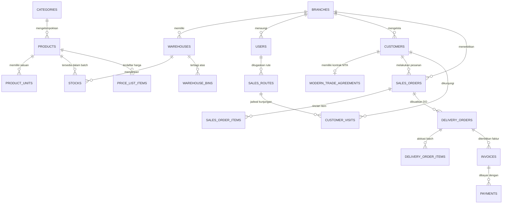

# 🚀 Enterprise Multi-Branch Sales & Distribution Management System (GT & MT)

Sistem Informasi Manajemen Penjualan dan Distribusi Skala Enterprise (*Multi-Branch & Multi-Warehouse*) berbasis **Laravel 11**, **PostgreSQL 16**, **Redis 7**, dan **Docker**. Dirancang khusus untuk mengakomodasi kompleksitas operasional distribusi FMCG di Indonesia yang melingkupi dua kanal utama: **General Trade (GT)** dan **Modern Trade (MT)**.

---

## 📑 Daftar Isi

- [1. Ringkasan Sistem & Perbedaan GT vs MT](#1-ringkasan-sistem--perbedaan-gt-vs-mt)
- [2. Fitur-Fitur Utama](#2-fitur-fitur-utama)
- [3. Arsitektur & Struktur Direktori](#3-arsitektur--struktur-direktori)
- [4. Skema Basis Data (Database Schema)](#4-skema-basis-data-database-schema)
- [5. Stack Teknologi](#5-stack-teknologi)
- [6. Panduan Instalasi & Menjalankan Aplikasi](#6-panduan-instalasi--menjalankan-aplikasi)
  - [Opsi A: Instalasi Cepat via Script Otomatis (Rekomendasi Docker)](#opsi-a-instalasi-cepat-via-script-otomatis-rekomendasi-docker)
  - [Opsi B: Instalasi Manual dengan Docker Compose](#opsi-b-instalasi-manual-dengan-docker-compose)
  - [Opsi C: Instalasi Lokal Tanpa Docker (Native Host)](#opsi-c-instalasi-lokal-tanpa-docker-native-host)
- [7. Kredensial Akun Bawaan (Demo Accounts)](#7-kredensial-akun-bawaan-demo-accounts)
- [8. Panduan Fitur & Endpoint Aplikasi](#8-panduan-fitur--endpoint-aplikasi)
- [9. Perintah Operasional & Pemeliharaan Docker](#9-perintah-operasional--pemeliharaan-docker)
- [10. Pemecahan Masalah (Troubleshooting)](#10-pemecahan-masalah-troubleshooting)

---

## 1. Ringkasan Sistem & Perbedaan GT vs MT

Dalam industri distribusi modern, karakteristik kanal pasar tradisional sangat berbeda dengan pasar ritel modern berjejaring:

| Aspek Operasional | Saluran General Trade (GT) 🏪 | Saluran Modern Trade (MT) 🏬 |
| :--- | :--- | :--- |
| **Profil Pelanggan** | Warung kelontong, toko sembako, agen grosir pasar, kios retail. | Supermarket chain (*Super Indo*, *Hero*), Hypermarket, Minimarket (*Indomaret*, *Alfamart*). |
| **Model Penjualan** | **Taking Order (TO)** via salesmen motor & **Kanvas** mobil box bawa stok langsung. | Key Account Management berbasis **PO Resmi (Purchase Order)** dari kantor pusat retail. |
| **Rute & Kunjungan** | *Beat Plan* harian, call sheet, validasi geo-tagging GPS & foto selfie toko. | Pengiriman terjadwal ke Distribution Center (DC) pusat atau pengiriman langsung per gerai (*Store Delivery*). |
| **Plafon Kredit & TOP** | Plafon kredit fleksibel, tenor pendek (7–14 hari) atau *Cash on Delivery (COD)*. | Tenor panjang (*Terms of Payment* 30–90 hari), sistem tukar faktur (*contra-bon*). |
| **Struktur Diskon** | Diskon reguler, diskon bertingkat kuantitas (diskon 1 + diskon 2), cash discount. | Perjanjian Dagang (**MTA**): Diskon on-invoice, off-invoice rebate tahunan, *listing fee*, *slotting fee*. |
| **Perpajakan & Faktur** | Nota penjualan fisik, kuitansi tunai, faktur sederhana. | Faktur Pajak elektronik (PPN 11%), e-faktur, berita acara serah terima (BAST). |

Sistem ini menyatukan kedua alur kerja tersebut dalam satu kesatuan data transaksi yang terintegrasi dari Head Office (Pusat) hingga operasional gudang dan lapangan.

---

## 2. Fitur-Fitur Utama

### A. Multi-Entity & Hierarki Organisasi
- **Multi-Branch & Multi-Warehouse**: Mendukung hierarki Head Office, Kantor Cabang (*Branch*), hingga Gudang Khusus (*Central DC*, *Branch Main Warehouse*, *Van Kanvas*, *Gudang Bad Stock/Karantina*, serta *Virtual In-Transit Warehouse*).
- **Role-Based Access Control (RBAC)**: Pengendalian hak akses granular untuk 8+ peran pengguna (Superadmin, Branch Manager, Admin Sales, KAM MT, Salesman GT, Warehouse Keeper, Finance, Billing Staff, dan AR Debt Collector).

### B. Saluran General Trade (GT)
- **Beat Plan & Rute Kunjungan**: Penjadwalan kunjungan toko harian salesmen GT berdasarkan hari (*Call Plan*).
- **Verifikasi Kunjungan Lapangan**: Pencatatan koordinat GPS (*geo-tagging*), selfie check-in, serta call status (*Order*, *No Order/Tutup*, *Follow Up*).
- **Penjualan Kanvas & Taking Order**: Fleksibilitas pemesanan langsung dari stok mobil kanvas atau *Taking Order* dengan penerbitan Delivery Order terpusat.

### C. Saluran Modern Trade (MT)
- **Modern Trade Agreement (MTA)**: Kontrak dagang mencakup persentase diskon *on-invoice*, persentase *off-invoice rebate*, biaya pendaftaran produk (*listing fee*), hingga biaya sewa rak (*slotting fee*).
- **Purchase Order (PO) Matching**: Validasi nomor PO resmi jaringan retail sebelum Sales Order dapat disetujui.
- **Tukar Faktur & Kontra-Bon**: Pelacakan jatuh tempo faktur pajak dan pengumpulan tanda terima tukar faktur.

### D. Pricing Engine & Order Management
- **Multi-Tier & Multi-UOM**: Dukungan multi-satuan per produk (misal: 1 Dus = 4 Pak = 24 Pcs) dengan konversi otomatis ke satuan terkecil (*base unit*).
- **Validasi Plafon Kredit Otomatis**: Pengecekan otomatis batas kredit pelanggan dan saldo piutang berjalan sebelum Sales Order diproses.
- **Pessimistic Row Locking**: Menghindari *overselling* saat pemesanan bersamaan dengan penguncian data pada tingkat baris basis data.

### E. Manajemen Gudang & Stok FEFO
- **First-Expired, First-Out (FEFO)**: Alokasi stok otomatis memprioritaskan batch produk dengan tanggal kedaluwarsa terdekat.
- **Manajemen Mutasi & Batch**: Pencatatan nomor lot/batch, tanggal kedaluwarsa, kuantitas *on hand*, serta kuantitas *reserved*.
- **Transfer Antar-Cabang (Inter-Branch)**: Pengiriman stok antar-gudang dengan status transit transparan (*Pending* &rarr; *In-Transit* &rarr; *Received*).
- **Advanced WMS**: Pemetaan tata letak gudang (*Warehouse Bin/Rak*), pencatatan sertifikat analisis (COA), dan proses *Goods Receipt* (Penerimaan Barang).

### F. Keuangan, Piutang (AR) & Pelaporan
- **Jadwal Umur Piutang (AR Aging Schedule)**: Pengelompokan piutang berjalan (0–30 hari, 31–60 hari, 61–90 hari, dan >90 hari overdue).
- **Rekonsiliasi Pembayaran Multi-Metode**: Pembayaran via Kas Tunai, Transfer Bank, Giro, dan Cek Kliring.
- **Dashboard Interaktif**: Metrik performa bisnis real-time, perbandingan omzet GT vs MT, ringkasan Sales Order, dan indikator tagihan kritis.

---

## 3. Arsitektur & Struktur Direktori

Aplikasi ini mengadopsi prinsip **Domain-Driven Design (DDD)** yang modular dan memisahkan logika bisnis kompleks (*business core*) dari antarmuka controller/HTTP:

```text
SALES/
├── app/
│   ├── Domain/                      # Arsitektur Domain Terisolasi (DDD)
│   │   ├── Customer/                # Domain Pelanggan & Kontrak Modern Trade (MTA)
│   │   │   └── Models/              # Customer, ModernTradeAgreement
│   │   ├── Inventory/               # Domain Stok & Mutasi
│   │   │   ├── Models/              # Stock, StockMutation
│   │   │   └── Services/            # StockReservationService (FEFO & Row Lock)
│   │   ├── Organization/            # Domain Cabang & Gudang
│   │   │   └── Models/              # Branch, Warehouse
│   │   ├── Pricing/                 # Domain Price List & Kalkulasi Harga
│   │   │   ├── Models/              # PriceList, PriceListItem
│   │   │   └── Services/            # PricingEngineService (Diskon GT & MT)
│   │   ├── Product/                 # Domain Produk & Satuan Multi-UOM
│   │   │   └── Models/              # Product, ProductUnit
│   │   ├── Sales/                   # Domain Transaksi Penjualan
│   │   │   ├── DTO/                 # CreateSalesOrderDTO, SalesOrderItemDTO
│   │   │   ├── Events/              # SalesOrderApprovedEvent
│   │   │   ├── Exceptions/          # CreditLimitExceededException, dll.
│   │   │   ├── Models/              # SalesOrder, SalesOrderItem
│   │   │   └── Services/            # CreateSalesOrderService, ApproveSalesOrderService
│   │   └── Warehouse/               # Domain Gudang Tingkat Lanjut (WMS)
│   │       ├── DTO/                 # CreateGoodsReceiptDTO, GoodsReceiptItemDTO
│   │       ├── Models/              # Batch, GoodsReceipt, WarehouseBin
│   │       └── Services/            # CreateGoodsReceiptService
│   ├── Http/Controllers/            # Lapisan Presentasi Web & API
│   │   ├── AuthController.php       # Login biasa & 1-Click Quick Demo Login
│   │   ├── CustomerController.php   # Manajemen Pelanggan & Plafon Kredit
│   │   ├── DashboardController.php  # Dashboard KPI, Omzet GT/MT & AR Aging
│   │   ├── FinanceController.php    # Faktur Pajak & Analitik Piutang
│   │   ├── InventoryController.php  # Monitoring Stok FEFO & Batch Gudang
│   │   ├── RoutePlanController.php  # Rute Salesman GT & Log Kunjungan Toko
│   │   └── SalesOrderController.php # Pembuatan & Monitoring Sales Order
│   └── Models/User.php              # Model Pengguna & Relasi Hak Akses
├── database/
│   ├── migrations/                  # 8 File Migrasi Normalisasi Relasional
│   ├── seeders/DatabaseSeeder.php   # Data Master Awal & Transaksi Contoh Komprehensif
│   ├── schema.dbml                  # Dokumentasi Skema Database (DBML Format)
│   └── schema.sql                   # Skema DDL Relasional Murni PostgreSQL
├── docker/
│   ├── entrypoint.sh                # Script Inisialisasi Kontainer PHP-FPM
│   ├── nginx/default.conf           # Konfigurasi Reverse Proxy Nginx
│   └── php/                         # Konfigurasi PHP (local.ini & opcache.ini)
├── resources/views/                 # Template Blade (Modern UI Tailwind CSS)
│   ├── auth/login.blade.php         # Halaman Login & Panel Quick Switch Akun Demo
│   ├── dashboard/index.blade.php    # Dashboard Metrik & Grafik
│   ├── layouts/app.blade.php        # Layout Induk Responsif dengan Sidebar
│   ├── sales/                       # Halaman Index, Create SO, & Show Detail
│   ├── customers/                   # Katalog Pelanggan & Limit Kredit
│   ├── inventory/                   # Status Batch FEFO & Gudang
│   ├── finance/                     # Jadwal AR Aging & Faktur
│   └── routes/                      # Peta Rute & Kunjungan Toko Salesman GT
├── routes/
│   ├── web.php                      # Rute Web UI & REST API Endpoints
│   └── console.php                  # Perintah Artisan Terjadwal
├── Dockerfile                       # Definisi Image PHP 8.3-FPM Multi-Extension
├── docker-compose.yml               # Orkestrasi 6 Layanan Container Production-Ready
└── init-system.sh                   # Script 1-Langkah Otomatisasi Instalasi
```

---

## 4. Skema Basis Data (Database Schema)

Sistem menggunakan skema basis data relasional ternormalisasi PostgreSQL dengan *Foreign Key constraints* ketat dan pengindeksan performa tinggi:



Dokumentasi skema lengkap dapat dilihat langsung di:
- [`database/schema.dbml`](file:///Users/legacygandawijaya/Documents/SALES/database/schema.dbml) *(Format DBML)*
- [`database/schema.sql`](file:///Users/legacygandawijaya/Documents/SALES/database/schema.sql) *(Format DDL PostgreSQL)*

---

## 5. Stack Teknologi

| Komponen | Teknologi | Keterangan |
| :--- | :--- | :--- |
| **Framework Utama** | Laravel 11.x | PHP Framework modern dengan arsitektur modular & DTO pattern. |
| **Runtime Bahasa** | PHP 8.3 (Alpine) | Dilengkapi ekstensi: `pdo_pgsql`, `pdo_mysql`, `redis`, `gd`, `zip`, `opcache`, `bcmath`, `intl`. |
| **Basis Data Relasional** | PostgreSQL 16 | ACID-compliant, performa tinggi, mendukung *pessimistic row locking* (`FOR UPDATE`). |
| **Cache & Queue Driver** | Redis 7 | Penyimpanan cache cepat, antrean proses pesanan latar belakang (*queue*), dan session driver. |
| **Web Server / Reverse Proxy**| Nginx (Alpine) | Penanganan HTTP statis & upstream FastCGI ke PHP-FPM. |
| **Frontend / Antarmuka** | Blade + Tailwind CSS | Antarmuka responsif dan modern dengan *Plus Jakarta Sans typography*. |
| **Containerization** | Docker & Docker Compose | Orkestrasi 6 container mandiri: `app`, `webserver`, `db`, `redis`, `queue_worker`, `scheduler`. |

---

## 6. Panduan Instalasi & Menjalankan Aplikasi

Anda dapat menjalankan aplikasi ini menggunakan **Docker Compose (sangat direkomendasikan)** atau secara langsung di sistem lokal Anda (*Native PHP Host*).

---

### Opsi A: Instalasi Cepat via Script Otomatis (Rekomendasi Docker)

Telah disediakan skrip otomatisasi [`init-system.sh`](file:///Users/legacygandawijaya/Documents/SALES/init-system.sh) yang melakukan seluruh proses setup (pengecekan file env, build container, migrasi basis data, seeding, hingga linking storage) dalam satu kali eksekusi:

1. **Buka Terminal / Console** dan masuk ke direktori proyek:
   ```bash
   cd /Users/legacygandawijaya/Documents/SALES
   ```

2. **Jalankan skrip inisialisasi**:
   ```bash
   ./init-system.sh
   ```
   *(Jika izin eksekusi belum aktif, jalankan `chmod +x init-system.sh` terlebih dahulu)*.

3. Tunggu hingga proses selesai. Setelah muncul pesan sukses, buka browser Anda di:
   - **URL Aplikasi**: [http://localhost:8080](http://localhost:8080)

---

### Opsi B: Instalasi Manual dengan Docker Compose

Jika Anda ingin menjalankan setiap tahapan Docker secara manual:

#### 1. Salin File Environment
```bash
cp .env.example .env
```
File `.env` sudah terkonfigurasi secara default untuk terhubung dengan container PostgreSQL (`db:5432`) dan Redis (`redis:6379`).

#### 2. Bangun dan Jalankan Kontainer Docker
```bash
docker compose up -d --build
```
Perintah ini akan menjalankan 6 kontainer di latar belakang:
- `sales_app` (PHP-FPM 8.3)
- `sales_webserver` (Nginx di port 8080)
- `sales_postgres` (PostgreSQL 16 di port 5432)
- `sales_redis` (Redis 7 di port 6379)
- `sales_queue_worker` (Worker pemroses antrean)
- `sales_scheduler` (Laravel schedule runner)

Periksa apakah semua kontainer telah berjalan normal:
```bash
docker compose ps
```

#### 3. Instal Dependensi Composer
```bash
docker compose exec app composer install --optimize-autoloader --no-interaction
```

#### 4. Buat Laravel Application Key
```bash
docker compose exec app php artisan key:generate
```

#### 5. Jalankan Migrasi Basis Data dan Seeder
```bash
docker compose exec app php artisan migrate --force
docker compose exec app php artisan db:seed --force
```

#### 6. Hubungkan Storage Link
```bash
docker compose exec app php artisan storage:link
```

#### 7. Buka Aplikasi di Browser
Buka browser favorit Anda dan akses:
👉 **[http://localhost:8080](http://localhost:8080)**

---

### Opsi C: Instalasi Lokal Tanpa Docker (Native Host)

Jika Anda ingin menjalankan aplikasi langsung di mesin lokal tanpa Docker:

#### 1. Prasyarat Sistem
- **PHP** versi 8.3 atau lebih baru (dengan ekstensi `pdo_pgsql` atau `pdo_mysql`, `mbstring`, `openssl`, `bcmath`, `curl`, `redis`).
- **Composer** versi 2.x.
- Server basis data **PostgreSQL 16** (atau MySQL 8.0).
- Server **Redis** aktif di port 6379.

#### 2. Setup Basis Data Lokal
Buat basis data baru pada PostgreSQL lokal Anda:
```sql
CREATE DATABASE sales_dist_db;
CREATE USER sales_admin WITH ENCRYPTED PASSWORD 'SecretSales2026!';
GRANT ALL PRIVILEGES ON DATABASE sales_dist_db TO sales_admin;
```

#### 3. Konfigurasi File `.env`
Salin `.env.example` ke `.env`:
```bash
cp .env.example .env
```
Sesuaikan konfigurasi koneksi basis data di `.env`:
```ini
DB_CONNECTION=pgsql
DB_HOST=127.0.0.1
DB_PORT=5432
DB_DATABASE=sales_dist_db
DB_USERNAME=sales_admin
DB_PASSWORD=SecretSales2026!

REDIS_HOST=127.0.0.1
REDIS_PORT=6379
```

#### 4. Instal Dependensi & Inisialisasi
```bash
composer install
php artisan key:generate
php artisan migrate --seed
php artisan storage:link
```

#### 5. Jalankan Server Pengembangan
```bash
php artisan serve --port=8080
```
Akses aplikasi melalui: **[http://localhost:8080](http://localhost:8080)**.

---

## 7. Kredensial Akun Bawaan (Demo Accounts)

Untuk mempermudah pengujian alur bisnis di berbagai tingkat jabatan dan kanal, sistem telah dilengkapi dengan data akun awal. 

> [!TIP]
> **Fitur 1-Click Login Cepat**: Pada halaman login (`http://localhost:8080/login`), terdapat tombol kartu instan di bagian bawah untuk langsung berganti peran tanpa harus mengetik alamat email dan kata sandi.

Semua akun di bawah ini menggunakan kata sandi seragam:
🔑 **Kata Sandi Default**: `Password2026!`

| Peran / Jabatan (*Role Title*) | Alamat Email | Lingkup Akses | Deskripsi Tugas |
| :--- | :--- | :---: | :--- |
| **Superadmin (HO)** | `superadmin@enterprisesales.co.id` | Semua Kanal (ALL) | Hak akses penuh seluruh cabang & konfigurasi sistem. |
| **Finance Controller (HO)** | `finance.ho@enterprisesales.co.id` | Semua Kanal (ALL) | Pengawasan keuangan konsolidasi & limit piutang. |
| **Branch Manager DKI Jakarta** | `bm.jkt@enterprisesales.co.id` | Semua Kanal (ALL) | Pimpinan operasional wilayah DKI Jakarta & persetujuan SO. |
| **Branch Manager Surabaya** | `bm.sby@enterprisesales.co.id` | Semua Kanal (ALL) | Pimpinan operasional wilayah Jawa Timur. |
| **Admin Sales Operasional** | `admin.sales@enterprisesales.co.id` | Semua Kanal (ALL) | Pembuatan dan verifikasi Sales Order harian. |
| **Key Account Manager (KAM)** | `kam.mt@enterprisesales.co.id` | Modern Trade (MT) | Pengelolaan kontrak MTA ritel (*Super Indo*, *Alfamart*). |
| **Salesman Taking Order (TO)** | `salesman.to@enterprisesales.co.id` | General Trade (GT) | Pengambilan pesanan toko kelontong & warung. |
| **Salesman Kanvas Mobil** | `salesman.kanvas@enterprisesales.co.id` | General Trade (GT) | Penjualan langsung membawa stok armada mobil box. |
| **Kepala Gudang (Warehouse)** | `warehouse.jkt@enterprisesales.co.id` | Semua Kanal (ALL) | Pengelolaan mutasi stok, stok opname, dan alokasi FEFO. |
| **Staff Billing & Faktur** | `billing.staff@enterprisesales.co.id` | Semua Kanal (ALL) | Penerbitan faktur pajak, tukar faktur, dan kuitansi. |
| **AR Debt Collector** | `collector.ar@enterprisesales.co.id` | General Trade (GT) | Penagihan piutang toko jatuh tempo di lapangan. |

---

## 8. Panduan Fitur & Endpoint Aplikasi

### Halaman Web Utama (Web UI)

1. **Dashboard & Analitik Bisnis** (`/dashboard`)
   - Rekap omzet total, rasio perbandingan omzet General Trade vs Modern Trade.
   - Ringkasan umur piutang (*AR Aging Schedule*).
   - Daftar pesanan penjualan terbaru dan status pemenuhan barang.
2. **Pesanan Penjualan (Sales Orders)** (`/sales-orders`)
   - Monitoring daftar pesanan masuk dengan indikator kanal (*GT* / *MT*).
   - Tombol **+ Buat Sales Order** (`/sales-orders/create`): formulir pembuatan SO lengkap dengan pilihan multi-satuan (Dus/Pak/Pcs), validasi plafon kredit, dan pengecekan ketersediaan stok FEFO.
   - Halaman detail Sales Order (`/sales-orders/{id}`).
3. **Data Pelanggan & Plafon Kredit** (`/customers`)
   - Daftar toko binaan GT dan gerai modern MT.
   - Pengecekan limit kredit (*Credit Limit*), penggunaan kredit berjalan (*Credit Used*), dan sisa plafon.
4. **Gudang & Stok FEFO** (`/inventory`)
   - Pemantauan stok per gudang (*Central DC*, *Armada Kanvas*, *Gudang Transit*).
   - Informasi nomor batch, tanggal kedaluwarsa, kuantitas fisik (*on-hand*), dan kuantitas teralokasi (*reserved*).
5. **Keuangan & Jadwal Umur Piutang (AR Aging)** (`/finance`)
   - Rekap faktur jatuh tempo (kategori 0–30 hari, 31–60 hari, 61–90 hari, dan >90 hari).
   - Status penerbitan Faktur Pajak dan pelunasan pembayaran.
6. **Rute & Kunjungan Salesman GT** (`/routes`)
   - Jadwal *Beat Plan* salesmen per hari.
   - Log kunjungan toko lapangan lengkap dengan titik koordinat GPS dan status kunjungan.

---

### REST API Endpoints (Integrasi & Mobile)

Sistem juga menyediakan endpoint REST API berformat JSON:

| Metode | Endpoint URL | Deskripsi Respon |
| :---: | :--- | :--- |
| `GET` | `/api/dashboard` | Statistik KPI ringkas, breakdown omzet per kanal, dan rekapitulasi AR Aging. |
| `GET` | `/api/sales-orders` | Data daftar Sales Order beserta nama pelanggan, kanal, status, dan nilai total. |
| `GET` | `/api/customers` | Data pelanggan lengkap dengan kanal, sisa kredit, dan jangka waktu pembayaran (*TOP*). |
| `GET` | `/api/stocks` | Data persediaan stok per gudang terurut berdasarkan tanggal kedaluwarsa (*FEFO*). |

---

## 9. Perintah Operasional & Pemeliharaan Docker

Berikut adalah kumpulan perintah yang sering digunakan untuk pemeliharaan aplikasi di lingkungan Docker:

### Memantau Log Kontainer
```bash
# Pantau seluruh log layanan secara real-time
docker compose logs -f

# Pantau hanya log aplikasi web/Laravel
docker compose logs -f app

# Pantau log Nginx webserver
docker compose logs -f webserver

# Pantau aktivitas worker antrean (Queue Worker)
docker compose logs -f queue_worker
```

### Menjalankan Perintah Artisan di Dalam Kontainer
```bash
# Menjalankan Laravel Tinker
docker compose exec app php artisan tinker

# Membersihkan dan me-refresh seluruh cache
docker compose exec app php artisan optimize:clear

# Mengoptimasi konfigurasi, route, dan view untuk performa tinggi
docker compose exec app php artisan optimize

# Reset ulang database dari awal (fresh migration + seeder ulang)
docker compose exec app php artisan migrate:fresh --seed
```

### Menghentikan dan Menyalakan Ulang Layanan
```bash
# Menghentikan kontainer tanpa menghapus data volume
docker compose down

# Menyalakan kembali kontainer
docker compose up -d

# Menyalakan ulang kontainer spesifik (misal: queue_worker setelah pembaruan kode)
docker compose restart queue_worker
```

---

## 10. Pemecahan Masalah (Troubleshooting)

### 1. Konflik Port di Komputer Host (Port 8080, 5432, atau 6379 Terpakai)
Jika port `8080`, `5432`, atau `6379` sudah digunakan oleh aplikasi lain di komputer Anda:
- Buka file `.env`.
- Ubah variabel port forwarding berikut sesuai port yang tersedia:
  ```ini
  APP_PORT=8090
  DB_PORT_FORWARD=5433
  REDIS_PORT_FORWARD=6380
  ```
- Terapkan perubahan dengan menjalankan: `docker compose up -d`.

### 2. Masalah Izin Berkas (*Permission Denied* pada Direktori Storage)
Jika muncul kendala izin penulisan pada folder storage atau cache:
```bash
docker compose exec app chown -R www:www /var/www/html/storage /var/www/html/bootstrap/cache
docker compose exec app chmod -R 777 /var/www/html/storage /var/www/html/bootstrap/cache
```

### 3. Database Belum Siap (*Connection Refused*)
Kontainer PostgreSQL membutuhkan waktu beberapa detik untuk proses inisialisasi awal. Pastikan Anda telah menunggu hingga health check berstatus `healthy` atau cek status koneksi melalui:
```bash
docker compose exec db pg_isready -U sales_admin -d sales_dist_db
```

---

## 📄 Lisensi & Hak Cipta

Proyek ini dikembangkan sebagai arsitektur sistem distribusi berskala enterprise untuk PT Enterprise Sales & Distribution System. Hak cipta dilindungi undang-undang.

