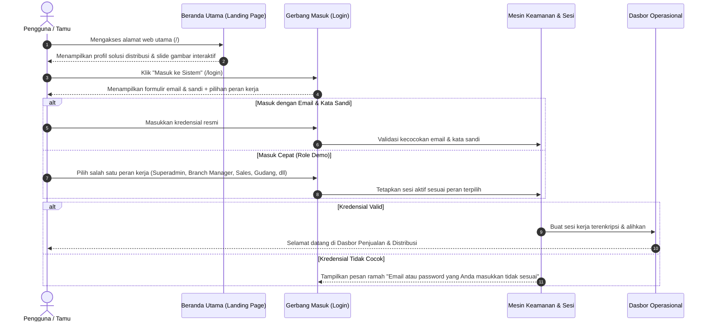

# Dokumen Proses Bisnis 01: Alur Login, Akses Sistem & Pendaftaran

Dokumen ini menjelaskan proses bisnis terkait gerbang masuk aplikasi, autentikasi pengguna, navigasi beranda utama, akses cepat berdasarkan peran operasional, pendaftaran mandiri perusahaan baru (*self-onboarding*), serta perlindungan privasi data secara menyeluruh.

---

## 1. Ikhtisar Alur Akses Pengguna

Aplikasi menerapkan pemisahan yang jelas antara gerbang publik dan zona kerja operasional internal. Pengunjung publik hanya diizinkan mengakses informasi pengenalan pada Beranda Utama (*Landing Page*) dan formulir autentikasi. Seluruh data transaksi, pelanggan, keuangan, dan stok barang terkunci aman di balik sistem autentikasi.

---

## 2. Rincian Proses Bisnis Langkah demi Langkah

### A. Kunjungan Halaman Beranda Utama (*Landing Page*)
- **Rute Web**: `/`
- **Tujuan**: Memberikan gambaran komprehensif bagi calon mitra, pelanggan, dan staf mengenai kapabilitas sistem distribusi multi-cabang tanpa memerlukan kata sandi.
- **Elemen Antarmuka**:
  - **Header Navigasi**: Logo resmi, pintasan menu (*Fitur Unggulan*, *Kanal GT & MT*, *Enam Pilar Modul*, *Alur Transaksi*, *Tanya Jawab*), dan tombol **Masuk ke Sistem**.
  - **Latar Belakang Slide Bergerak**: Slide gambar beresolusi tinggi yang berotasi otomatis setiap 5 detik (Gudang Distribusi, Armada Truk Logistik, Gerai Ritel Modern Trade, Toko Kelontong Pasar Tradisional). Konten ini dapat diubah langsung dari menu manajemen dasbor.
  - **Kartu Metrik & Bukti Nyata**: Menampilkan pencapaian operasional (Total Pengiriman Berhasil, Kecepatan Pemrosesan Surat Jalan, Ketepatan Penagihan Piutang, Tingkat Retur Terkendali).
  - **Footer Resmi**: Informasi profil solusi distribusi terpadu dan tautan pencipta resmi `phobehub.com`.

### B. Masuk ke Akun (*Login*) & Validasi Kredensial
- **Rute Web**: `/login` (Formulir) & `/login` via POST (Proses Masuk)
- **Tujuan**: Memastikan hanya pengguna yang berhak dan terdaftar aktif yang dapat membuka data perusahaan.
- **Aturan Bisnis & Validasi**:
  1. Alamat email harus memiliki format yang valid dan berstatus aktif (`is_active = true`).
  2. Kata sandi dicocokkan dengan standar keamanan enkripsi.
  3. Fitur **Ingat Saya**: Jika dicentang, sesi login akan dipertahankan di peramban pengguna.
  4. Jika akun pengguna berstatus dinonaktifkan oleh administrator, sistem akan menolak akses untuk mencegah penyalahgunaan oleh mantan karyawan.

### C. Masuk Cepat Berdasarkan Peran Kerja (*1-Click Role Login*)
- **Rute Web**: `/login/quick/{id}`
- **Tujuan**: Memfasilitasi simulasi, pengujian operasional, pelatihan staf baru, dan presentasi alur bisnis secara langsung tanpa repot mengingat kata sandi yang berbeda-beda untuk tiap departemen.
- **Pilihan Peran yang Tersedia**:
  - `Hendrawan Pratama` &mdash; **Super Administrator** (Akses penuh lintas cabang, kuota perusahaan, konfigurasi beranda, dan audit log).
  - `Gunawan Wibisono` &mdash; **Finance Controller HO** (Otorisasi keuangan, persetujuan batas kredit, analisis umur piutang, rekonsiliasi kas/bank).
  - `Budi Santoso` &mdash; **Branch Manager DKI Jakarta** (Persetujuan Sales Order cabang Jakarta, izin dispensasi tagihan tertunda, transfer antar-gudang).
  - `Bambang Trihatmodjo` &mdash; **Branch Manager Surabaya** (Persetujuan operasional regional Jawa Timur).
  - `Dewi Sartika` &mdash; **Admin Sales Operasional** (Input Sales Order harian, penerbitan surat penawaran, rekap data pelanggan).
  - `Citra Lestari` &mdash; **Key Account Manager Modern Trade (KAM MT)** (Pengelolaan kontrak dagang supermarket/hypermarket, verifikasi PO ritel, tukar faktur).
  - `Ahmad Fauzi` &mdash; **Salesman Taking Order GT** (Rute Beat Plan, kunjungan toko kelontong, pencatatan pesanan).
  - `Rahmat Hidayat` &mdash; **Salesman Kanvas Mobil GT** (Penjualan barang langsung bawa stok di mobil van).
  - `Joko Waluyo` &mdash; **Kepala Gudang Cakung** (Penerbitan surat jalan, pemotongan stok FEFO, pemeriksaan fisik stok opname).
  - `Ratna Sari` &mdash; **Staff Billing & Faktur Pajak** (Penerbitan faktur penjualan dan faktur pajak PPN 11%).
  - `Surya Saputra` &mdash; **Kolektor Piutang (AR Collector)** (Penagihan faktur jatuh tempo di lapangan).

### D. Pendaftaran Mandiri Perusahaan Baru (*SaaS Tenant Self-Onboarding*)
- **Rute Web**: `/register-tenant` (Formulir) & `/register-tenant` via POST (Proses Pendaftaran)
- **Tujuan**: Memungkinkan perusahaan distributor baru untuk mendaftarkan perusahaannya secara mandiri ke dalam ekosistem sistem.
- **Data yang Diinputkan**:
  1. **Informasi Perusahaan**: Nama resmi perusahaan, kode perusahaan, dan subdomain identitas unik.
  2. **Paket Langganan**: Pemilihan paket (*Starter*, *Professional*, atau *Enterprise*) yang menentukan kuota maksimal pengguna, cabang, dan gudang.
  3. **Kredensial Administrator Pertama**: Nama pimpinan, alamat email resmi kantor, dan kata sandi baru.
- **Hasil Pendaftaran**:
  - Sistem secara otomatis membuat entitas perusahaan baru, membuat cabang kantor pusat (*Head Office*), membuat gudang pusat perdana, dan mendaftarkan pengguna tersebut sebagai Superadmin perusahaan terkait.
  - Sesi otomatis diarahkan langsung ke Dasbor Perusahaan baru.

### E. Keluar dari Sistem (*Logout*) & Pengamanan Sesi
- **Rute Web**: `/logout` (POST atau GET)
- **Prosedur**:
  1. Sistem membatalkan (*invalidate*) token sesi aktif dari server.
  2. Regenerasi token keamanan untuk mencegah pembajakan sesi (*session hijacking*).
  3. Mengalihkan pengguna kembali ke halaman `/login` dengan notifikasi pesan ramah: *"Anda telah berhasil keluar dari sistem."*

---

## 3. Kebijakan Keamanan & Perlindungan Privasi Data

Untuk menjamin kepatuhan terhadap regulasi privasi data:
1. **Penguncian Rute Total**: Seluruh halaman operasional (`/dashboard`, `/customers`, `/sales-orders`, `/finance`, `/inventory`, `/users`, dll.) diwajibkan melewati pemeriksaan sesi masuk aktif (*Auth Middleware*).
2. **Perlindungan Terhadap Pihak Luar**:
   - Jika pengunjung tanpa login mencoba membuka halaman operasional di peramban, sistem otomatis mengalihkannya ke halaman `/login`.
   - Jika permohonan data dilakukan via protokol data (API/JSON) tanpa otentikasi, sistem memberikan respons penolakan resmi `401 Unauthorized` dengan pesan ramah *"Unauthenticated."* tanpa memaparkan nama pelanggan, nilai penjualan, maupun saldo stok sedikitpun.
3. **Penyembunyian Jejak Teknis**: Seluruh nama basis data, versi perangkat lunak mesin, atau istilah pengembang tidak ditampilkan di antarmuka publik, menjamin citra profesional perusahaan dan memperkuat pertahanan keamanan siber.

