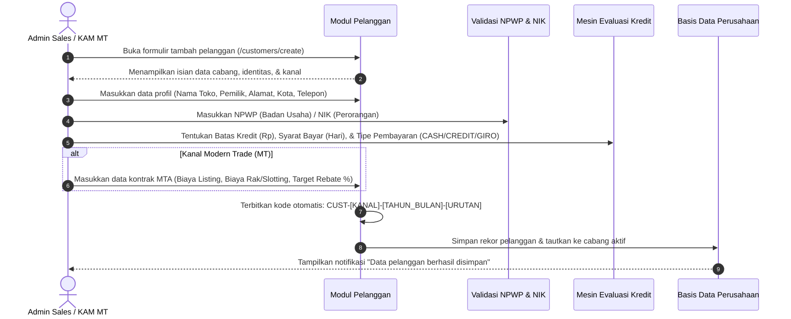
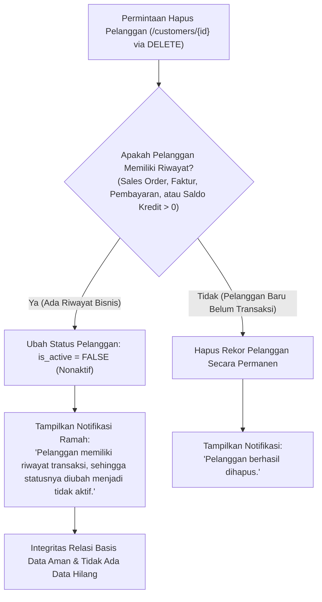

# Dokumen Proses Bisnis 02: Manajemen Pelanggan, Plafon Kredit & Kontrak Dagang

Dokumen ini menjelaskan alur pengelolaan data induk (*master data*) pelanggan, penetapan plafon batas kredit (*credit limit*), syarat jatuh tempo pembayaran (*Term of Payment / TOP*), integrasi kontrak dagang Modern Trade (*MTA*), serta mekanisme perlindungan integritas data saat penghapusan pelanggan.

---

## 1. Klasifikasi Saluran Pelanggan

Sistem membedakan pelanggan ke dalam dua saluran distribusi utama yang memiliki karakteristik bisnis berbeda secara mendasar:

```
                  ┌──────────────────────────────────────────────┐
                  │            MASTER DATA PELANGGAN             │
                  └──────────────────────┬───────────────────────┘
                                         │
                 ┌───────────────────────┴───────────────────────┐
                 ▼                                               ▼
   ┌───────────────────────────┐                   ┌───────────────────────────┐
   │    GENERAL TRADE (GT)     │                   │    MODERN TRADE (MT)      │
   ├───────────────────────────┤                   ├───────────────────────────┤
   │ • Warung & Kios           │                   │ • Supermarket             │
   │ • Toko Kelontong          │                   │ • Hypermarket             │
   │ • Grosir & Semi-Grosir    │                   │ • Minimarket Chain        │
   │ • Pembayaran Kas / TOP 7  │                   │ • Kontrak Dagang (MTA)    │
   │ • Layanan Salesman TO/Van │                   │ • TOP Panjang (30-60 hari)│
   │ • Penagihan Kolektor      │                   │ • Prosedur Tukar Faktur   │
   └───────────────────────────┘                   └───────────────────────────┘
```

---

## 2. Alur Registrasi Pelanggan Baru

Proses penambahan pelanggan baru dilakukan melalui formulir terpadu dengan validasi lengkap di tingkat kantor cabang:



---

## 3. Tata Kelola Plafon Batas Kredit (*Credit Limit Management*)

Batas kredit adalah instrumen mitigasi risiko gagal bayar yang sangat krusial bagi distributor:

1. **Komponen Saldo Kredit**:
   - **Batas Kredit (*Credit Limit*)**: Nilai maksimal piutang yang diizinkan untuk pelanggan tersebut.
   - **Kredit Terpakai (*Current Credit Used*)**: Total akumulasi nilai pesanan yang sedang berjalan ditambah nilai faktur yang belum lunas.
   - **Sisa Kredit Tersedia**: Selisih antara Batas Kredit dengan Kredit Terpakai:
     $$\text{Sisa Kredit Tersedia} = \text{Batas Kredit} - \text{Kredit Terpakai}$$
2. **Pemicu Perubahan Saldo Kredit**:
   - **Bertambah (Mengurangi Sisa)**: Terjadi saat Sales Order disetujui (*Approved*).
   - **Berkurang (Memulihkan Sisa)**: Terjadi saat pembayaran pelanggan dicatat dan dialokasikan ke faktur terbuka, atau saat pesanan dibatalkan/ditolak.
3. **Pengendalian Pesanan Baru**:
   - Jika nilai Sales Order baru menyebabkan kredit terpakai melebihi plafon yang ditetapkan, sistem tidak membatalkan pesanan, melainkan mengalihkan status pesanan ke **Menunggu Persetujuan (*PENDING_APPROVAL*)** agar ditinjau oleh Branch Manager.

---

## 4. Perjanjian Kontrak Dagang Modern Trade (*Modern Trade Agreement / MTA*)

Khusus untuk pelanggan jaringan ritel modern (Hero, Indomaret, Alfamart, Super Indo, GrandLucky, Lotte Mart), hubungan bisnis diikat oleh kontrak dagang resmi:

| Komponen Kontrak MTA | Penjelasan Bisnis & Penerapannya |
| :--- | :--- |
| **Nomor Kontrak Dagang** | Nomor unik kontrak kerja sama dagang bilateral (Contoh: `MTA-2026-HERO01`). |
| **Biaya Pendaftaran Produk (*Listing Fee*)** | Biaya investasi yang dibayarkan oleh distributor kepada ritel agar produk baru dapat masuk ke rak display toko ritel. |
| **Biaya Sewa Ruang Rak (*Slotting Fee*)** | Biaya sewa penempatan produk di posisi rak strategis (*eye-level* atau *end-cap gondola*). |
| **Target Potongan Akhir Periode (*Target Rebate %*)** | Persentase insentif rabat di luar faktur (*off-invoice rebate*) yang wajib diberikan distributor kepada ritel jika target akumulasi omset tahunan tercapai. |
| **Syarat Jatuh Tempo (*Payment Terms*)** | Jangka waktu pelunasan yang disepakati (umumnya berkisar 30, 45, hingga 60 hari setelah tanggal tukar faktur). |

---

## 5. Fitur Pencarian Cerdas & Rekap Profil Pelanggan

Antarmuka master pelanggan dilengkapi kemampuan pencarian multi-parameter:
- **Pencarian Cepat (*Universal Search*)**: Mencari secara *case-insensitive* berdasarkan Nama Toko, Kode Pelanggan, Kota, atau Nama Pemilik Toko.
- **Filter Berdasarkan Kanal**: Memisahkan tampilan khusus toko General Trade atau gerai Modern Trade.
- **Filter Berdasarkan Cabang**: Membantu Branch Manager mengawasi portofolio pelanggan di wilayah operasionalnya.
- **Halaman Profil Lengkap Pelanggan (`/customers/{id}`)**:
  - Menampilkan ringkasan finansial: Total Belanja Akumulatif, Sisa Batas Kredit, dan Tagihan Terbuka.
  - Tab Riwayat Transaksi: Daftar seluruh Sales Order, Surat Jalan Pengiriman, Faktur Penjualan, dan Rekam Pembayaran yang pernah tercatat untuk pelanggan tersebut.

---

## 6. Kebijakan Perlindungan Integritas Hapus Data (*Safe Deactivation*)

Untuk menjaga keakuratan laporan keuangan, jejak audit akuntansi, dan kepatuhan perpajakan:



Dengan mekanisme ini, riwayat penjualan masa lalu tidak akan rusak atau hilang (*zero broken relation*), namun pelanggan yang sudah nonaktif tidak akan muncul lagi di daftar pilihan pembuatan pesanan baru.

