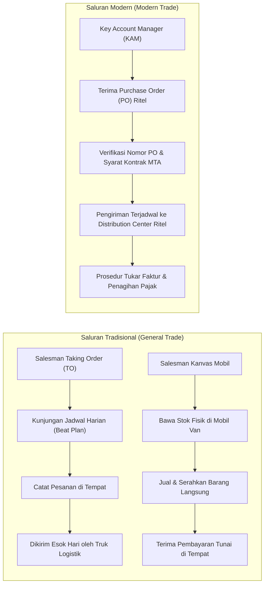
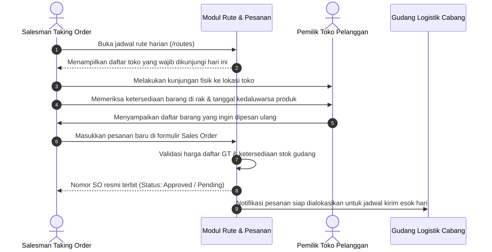
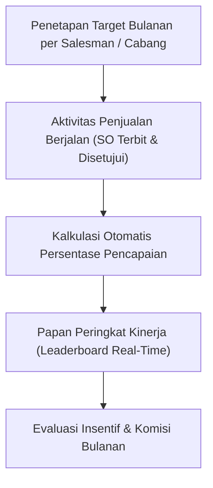

# Dokumen Proses Bisnis 03: Saluran Distribusi, Rute Kunjungan & Kinerja Penjualan

Dokumen ini menjelaskan alur operasional di lini terdepan penjualan (*field sales*), mencakup perbedaan strategi antara saluran pasar tradisional (*General Trade / GT*) dan jaringan ritel modern (*Modern Trade / MT*), tata kelola jadwal kunjungan toko harian (*Beat Plan*), alur kerja salesman kanvas bawa stok mobil, pemrosesan pesanan resmi supermarket, serta pemantauan target kinerja penjualan.

---

## 1. Peta Strategi Saluran Distribusi

Sistem mengakomodasi dua model operasi penjualan utama dalam industri distribusi barang konsumen (*FMCG*):



---

## 2. Alur Salesman Taking Order (TO) & Jadwal Rute (*Beat Plan*)

Salesman Taking Order bertugas mengunjungi warung, toko kelontong, dan grosir secara terjadwal untuk mengambil pesanan tanpa membawa stok fisik di kendaraan:



### Standar Operasional Jadwal Kunjungan (*Beat Plan*):
1. **Frekuensi Kunjungan**:
   - Toko Grosir Utama: 2x seminggu.
   - Toko Kelontong Sedang: 1x seminggu.
   - Warung Kecil: 1x dalam 2 minggu.
2. **Kepatuhan Rute (*Call Compliance*)**: Kunjungan di luar jadwal yang telah ditetapkan memerlukan pencatatan alasan (*Unplanned Call*).

---

## 3. Alur Salesman Kanvas Mobil (*Direct Van Sales*)

Salesman kanvas menggunakan kendaraan boks (*van*) yang telah diisi muatan barang dagangan di pagi hari untuk melayani pembelian tunai secara langsung di lokasi toko:

```
  07:00 Pagi                    Siang Hari                   17:00 Sore
┌─────────────────────────┐   ┌─────────────────────────┐   ┌─────────────────────────┐
│ MUAT BARANG KE MOBIL    │   │ TRANSAKSI DI TOKO       │   │ REKONSILIASI AKHIR HARI │
│ • Ajukan permohonan     │   │ • Kunjungi toko         │   │ • Hitung sisa stok fisik│
│   stok kanvas ke gudang │   │ • Serahkan barang fisik │     di dalam mobil van      │
│ • Transfer stok dari    │   │ • Cetak nota penjualan  │ • Setor uang kas ke kasir   │
│   Gudang Utama ke       │   │ • Terima uang tunai /   │ • Kembalikan sisa stok      │
│   Gudang Mobil Van      │   │   faktur kredit pendek  │   ke gudang utama atau simpan│
│ • Cek kesesuaian fisik  │   │ • Stok di mobil berkurang│  untuk rute esok hari     │
└─────────────────────────┘   └─────────────────────────┘   └─────────────────────────┘
```

### Aturan Rekonsiliasi Kanvas:
$$\text{Stok Awal Van} - \text{Total Penjualan di Rute} - \text{Retur Masuk} = \text{Sisa Stok Fisik di Mobil}$$
Jika terdapat selisih antara nilai uang tunai yang disetor dengan total penjualan kanvas, kasir cabang akan menerbitkan formulir selisih kas kanvas untuk ditelusuri.

---

## 4. Alur Penjualan Modern Trade (MT) & Validasi PO Ritel

Penjualan ke supermarket, hypermarket, atau jaringan minimarket memiliki karakteristik berbasis pesanan resmi (*Purchase Order / PO*):

1. **Penerimaan Dokumen PO Ritel**: Ritel modern menerbitkan dokumen PO elektronik (EDI) atau berkas fisik dengan nomor kontrak kerja sama.
2. **Pencatatan Nomor PO Ritel di Sistem**:
   - Kolom `po_number_mt` wajib diisi saat membuat Sales Order kanal MT.
   - Sistem memeriksa kesesuaian antara nomor PO dengan pelanggan MT yang ditunjuk.
3. **Pencocokan Harga Kontrak Dagang (MTA)**:
   - Harga jual yang digunakan otomatis mengacu pada Daftar Harga Khusus MT (`PL-MT-CHAIN`) atau harga yang terkunci pada kesepakatan MTA.
   - Potongan rabat di luar faktur (*off-invoice rebate*) dicatat terpisah untuk keperluan rekonsiliasi akhir tahun.
4. **Jendela Waktu Pengiriman (*Delivery Time Window*)**:
   - Ritel modern memberlakukan jam penerimaan barang yang ketat di gudang pusat mereka (*Central DC*). Keterlambatan dapat dikenai penolakan atau denda layanan (*penalty fee*).

---

## 5. Manajemen Target Penjualan & Papan Peringkat Kinerja (*Leaderboard*)

Sistem menyediakan modul pemantauan kinerja penjualan (`/sales-targets`) untuk mendorong transparansi dan pencapaian target bisnis:



### Metrik Evaluasi Kinerja Salesman:
- **Pencapaian Omset (*Value Target*)**: Total nominal rupiah dari Sales Order yang telah disetujui dibandingkan dengan target bulanan.
- **Efektivitas Kunjungan (*Effective Call / EC*)**: Rasio antara jumlah toko yang berhasil bertransaksi (*beli*) terhadap total toko yang dikunjungi.
- **Penyebaran Produk (*Distribution Width*)**: Keberhasilan menjual produk-produk fokus (*SKU Prioritas*) ke jaringan toko pelanggan baru.

