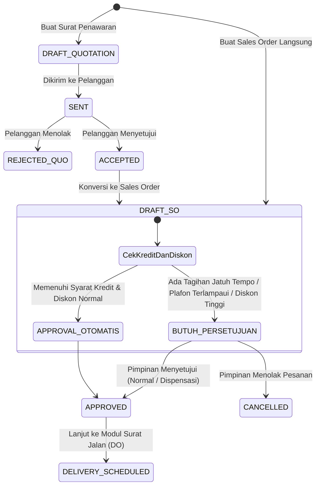
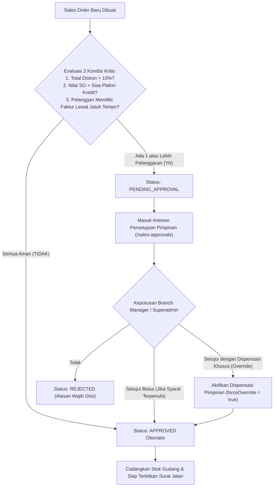

# Dokumen Proses Bisnis 04: Penawaran Harga, Mesin Harga & Persetujuan Pesanan

Dokumen ini menjelaskan alur penerbitan Surat Penawaran Harga (*Sales Quotation*), arsitektur mesin penetapan harga multi-satuan (*Pricing Engine*), konversi penawaran ke Pesanan Penjualan (*Sales Order*), alur persetujuan bertingkat (*Approval Workflow*), serta fasilitas dispensasi pimpinan (*Leadership Override*) yang menjamin operasional bisnis berjalan lancar tanpa hambatan kaku.

---

## 1. Siklus Hidup Penawaran & Pesanan Penjualan



---

## 2. Pembuatan Surat Penawaran Harga (*Sales Quotation*)
- **Rute Web**: `/quotations/create` (Formulir) & `/quotations` (Katalog)
- **Tujuan**: Memberikan estimasi harga resmi berjangka waktu kepada pelanggan sebelum kesepakatan pembelian difinalisasi.
- **Komponen Penawaran**:
  1. **Nomor Penawaran**: Format resmi otomatis (Contoh: `QUO-202610-0001`).
  2. **Masa Berlaku Penawaran (*Expiry Date*)**: Umumnya berlaku selama 7 hingga 14 hari kalender.
  3. **Rincian Barang**: Produk, satuan yang dipilih (Karton/Dus, Pak, Botol/Pcs), jumlah pesanan, persentase diskon promo, dan PPN 11%.
  4. **Status Penawaran**: `DRAFT`, `SENT` (Terkirim), `ACCEPTED` (Disetujui Pelanggan), `REJECTED` (Ditolak Pelanggan), atau `CONVERTED` (Telah Ditransformasikan ke Sales Order).

---

## 3. Mesin Penetapan Harga Multi-Satuan (*Tiered Pricing Engine*)

Untuk menghindari kesalahan penetapan harga dan mencegah pesan error saat pelanggan memesan satuan yang berbeda, sistem menerapkan **5 Lapis Resolusi Harga Mandiri**:

```
                       PERMINTAAN HARGA PRODUK & SATUAN
                                       │
                                       ▼
  ┌────────────────────────────────────────────────────────────────────────┐
  │ 1. LAPIS PERTAMA: Daftar Harga Khusus Pelanggan                        │
  │    Memeriksa apakah pelanggan memiliki daftar harga khusus perorangan. │
  └────────────────────────────────────┬───────────────────────────────────┘
                                       │ Tidak ditemukan
                                       ▼
  ┌────────────────────────────────────────────────────────────────────────┐
  │ 2. LAPIS KEDUA: Daftar Harga Berdasarkan Saluran (GT / MT)             │
  │    Memeriksa daftar harga standar untuk saluran GT atau MT.            │
  └────────────────────────────────────┬───────────────────────────────────┘
                                       │ Tidak ditemukan
                                       ▼
  ┌────────────────────────────────────────────────────────────────────────┐
  │ 3. LAPIS KETIGA: Lintas Daftar Harga Aktif Perusahaan                   │
  │    Mencari harga pada daftar harga aktif lainnya di perusahaan.        │
  └────────────────────────────────────┬───────────────────────────────────┘
                                       │ Satuan belum terdaftar
                                       ▼
  ┌────────────────────────────────────────────────────────────────────────┐
  │ 4. LAPIS KEEMPAT: Konversi Proporsional Antar-Satuan Kemasan (UOM)     │
  │    Jika harga Karton ada (isi 24), maka harga eceran = Harga Karton/24 │
  └────────────────────────────────────┬───────────────────────────────────┘
                                       │ Tidak ada harga sama sekali
                                       ▼
  ┌────────────────────────────────────────────────────────────────────────┐
  │ 5. LAPIS KELIMA: Penetapan Otomatis Berbasis Biaya Baku Pokok (COGS)   │
  │    Harga dihitung otomatis: Biaya Standar Pokok + Keuntungan Normal 25%│
  └────────────────────────────────────────────────────────────────────────┘
```

Dengan arsitektur ini, pengguna tidak akan pernah menemui kendala terhenti akibat harga produk yang belum terdaftar untuk satuan tertentu.

---

## 4. Konversi Penawaran Menjadi Pesanan Penjualan (*Quotation Conversion*)
- **Rute Web**: `/quotations/{id}/convert`
- **Mekanisme**:
  1. Memvalidasi bahwa surat penawaran berstatus `ACCEPTED` dan belum pernah dikonversi sebelumnya.
  2. Mengunci (*snapshot*) harga barang, persentase diskon, dan ketentuan yang tercantum pada surat penawaran agar tidak terpengaruh oleh kenaikan harga reguler di kemudian hari.
  3. Memilih gudang pengeluaran barang di cabang terkait.
  4. Menerbitkan Sales Order resmi yang bertaut langsung ke identitas surat penawaran asal.

---

## 5. Alur Persetujuan Fleksibel Berjenjang (*Approval Workflow*)
- **Rute Web**: `/sales-approvals`
- **Tujuan**: Menyeimbangkan antara kepatuhan mitigasi risiko piutang dengan kelincahan pencapaian target penjualan.



### Fasilitas Dispensasi Khusus Pimpinan (*Leadership Override*):
Dalam situasi bisnis nyata, seringkali pelanggan besar yang terlambat membayar faktur tempo beberapa hari tetap perlu dikirimkan barang mendesak demi menjaga hubungan kemitraan strategis. 

Fitur **Setujui dengan Dispensasi** memungkinkan Branch Manager atau Superadmin untuk meloloskan pesanan tersebut dengan satu tombol, disertai pencatatan identitas pemberi izin dan waktu persetujuan pada buku catatan riwayat (*Approval History*).

---

## 6. Pencadangan Stok Barang Otomatis (*Stock Reservation*)

Ketika Sales Order berstatus **Disetujui (*APPROVED*)**:
1. Sistem menghitung kebutuhan fisik barang dalam satuan terkecil (*base UOM*).
2. Nilai stok cadangan (`qty_reserved`) pada gudang terpilih bertambah sesuai jumlah pesanan.
3. Stok yang tersedia untuk dijual (*Available to Promise / ATP*) otomatis berkurang:
   $$\text{Stok Tersedia Dijual} = \text{Stok Fisik di Gudang} - \text{Stok Cadangan}$$
4. Hal ini mencegah terjadinya penjualan ganda (*overselling*) atas barang yang sama oleh tenaga penjual lain.

