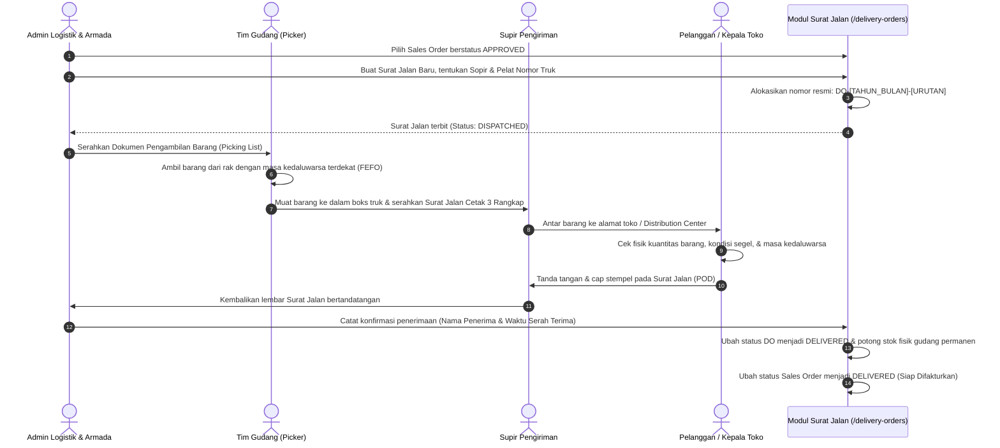

# Dokumen Proses Bisnis 05: Logistik, Pengiriman Armada & Bukti Serah Terima

Dokumen ini menjelaskan alur operasional logistik pengiriman barang, mulai dari penerbitan dokumen Surat Jalan (*Delivery Order / DO*), alokasi kendaraan armada dan penugasan supir, pengambilan fisik barang di gudang dengan aturan kedaluwarsa terdekat (*FEFO*), pencetakan dokumen serah terima 3 rangkap, hingga pencatatan Bukti Penerimaan Barang (*Proof of Delivery / POD*).

---

## 1. Siklus Operasional Logistik & Pengiriman

---

## 2. Rincian Langkah Operasional Pengiriman

### A. Penerbitan Surat Jalan (*Delivery Order / DO*)
- **Rute Web**: `/delivery-orders/create` & `/delivery-orders`
- **Prasyarat**: Sales Order harus berstatus **Disetujui (*APPROVED*)** dan memiliki stok cadangan yang memadai.
- **Data yang Diinputkan**:
  1. Nomor Sales Order rujukan.
  2. Tanggal rencana pengiriman armada.
  3. Jenis pengiriman (`DIRECT_STORE` untuk antar langsung ke toko, atau `CENTRAL_DC` untuk pengiriman ke gudang konsolidasi ritel).
  4. Nama Supir (*Driver Name*) dan Nomor Polisi Kendaraan (Contoh: `B 9123 SXY`).
  5. Catatan instruksi khusus bagi supir (Misal: *"Kirim sebelum pukul 12.00 WIB, pintu bongkar muat barat"*).

### B. Pengambilan Barang di Gudang (*Picking & FEFO Allocation*)
- Petugas gudang mencocokkan rincian barang pada lembar pengambilan.
- Pengambilan wajib mengambil nomor batch barang yang memiliki tanggal kedaluwarsa paling dekat dengan hari ini (*First-Expired, First-Out*).
- Hal ini menjamin barang yang dikirimkan ke pelanggan selalu memiliki sisa masa simpan (*shelf-life*) yang aman dan memenuhi standar penerimaan supermarket (minimal 70% sisa masa simpan).

### C. Dokumen Cetak Surat Jalan Resmi 3 Rangkap
- **Rute Cetak**: `/delivery-orders/{id}/print`
- Dokumen dicetak dalam 3 rangkap berpenanda warna standar distribusi:
  1. **Lembar Asli (Putih)**: Diserahkan kepada toko/pelanggan sebagai bukti hak milik barang dan rujukan penerimaan.
  2. **Lembar Kedua (Merah/Kuning)**: Ditandatangani dan dicap oleh toko, kemudian dibawa kembali oleh supir untuk diserahkan ke bagian Keuangan (*Billing*) sebagai lampiran penagihan faktur.
  3. **Lembar Ketiga (Hijau/Biru)**: Disimpan di arsip gudang cabang sebagai dokumen pertanggungjawaban fisik pengeluaran barang.

### D. Konfirmasi Penerimaan Barang (*Proof of Delivery / POD*)
- **Rute Web**: `/delivery-orders/{id}/deliver` (via POST)
- **Prosedur Pencatatan**:
  1. Admin Logistik membuka data Surat Jalan terkait.
  2. Memasukkan **Nama Jelas Penerima Barang** (Contoh: *Ibu Rina - Kepala Toko* atau *Pak Joko - Koordinator Receiving*).
  3. Mengonfirmasi tanggal dan jam barang diserahterimakan secara sah.
- **Efek Transaksi pada Sistem**:
  - Status Surat Jalan berubah menjadi **Terkirim (*DELIVERED*)**.
  - Jumlah fisik barang di gudang (`qty_on_hand`) dipotong secara permanen.
  - Jumlah cadangan barang (`qty_reserved`) dihapus.
  - Riwayat pengeluaran barang dicatat pada Buku Besar Mutasi Stok (*Stock Ledger*).
  - Pesanan Penjualan asal otomatis siap untuk diterbitkan Fakturnya oleh tim Keuangan.

---

## 3. Penanganan Pengiriman Parsial (*Partial Delivery*) & Pembatalan

Dalam kondisi operasional tertentu:
1. **Pengiriman Bertahap (Sebagian)**:
   - Jika kapasitas muat armada truk tidak mencukupi untuk mengangkut seluruh pesanan sekaligus, sistem mengizinkan penerbitan Surat Jalan parsial.
   - Status Sales Order akan berada pada posisi **Terkirim Sebagian (*PARTIALLY_DELIVERED*)** sampai sisa barang dikirimkan pada jadwal berikutnya.
2. **Koreksi atau Pembatalan Pengiriman**:
   - Jika armada mengalami kendala di perjalanan sebelum tiba di lokasi (misal: mogok atau musibah jalan), status Surat Jalan dapat diperbarui dengan catatan rute.
   - Jika barang batal dikirim, alokasi stok cadangan di gudang dapat dikembalikan utuh ke stok siap jual tanpa merusak integritas data.

