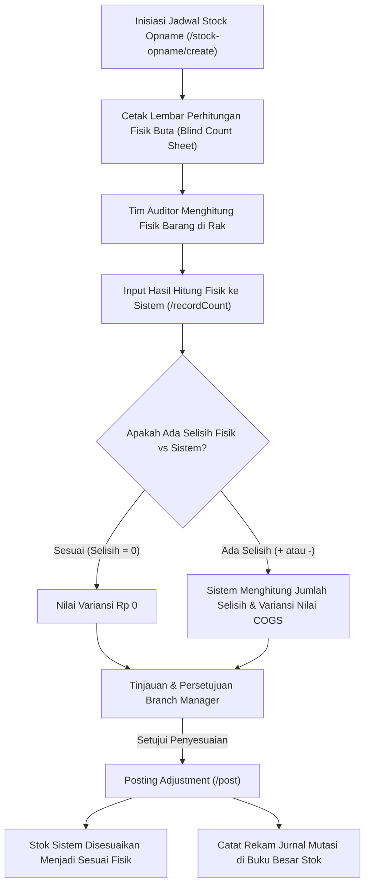

# Dokumen Proses Bisnis 06: Pergudangan, Manajemen Stok & Transfer Antar-Gudang

Dokumen ini menjelaskan tata kelola pergudangan terpadu multi-cabang, implementasi aturan pengeluaran barang kedaluwarsa terdekat (*FEFO*), prosedur transfer stok antar-gudang, siklus pemeriksaan stok fisik (*Stock Opname*), serta pencatatan Buku Besar Mutasi Stok (*Stock Ledger*) yang permanen.

---

## 1. Arsitektur Jaringan Multi-Gudang

Sistem mendukung tata letak multi-gudang dengan fungsi operasional yang terspesialisasi:

```
                          ┌────────────────────────────┐
                          │ GUDANG PUSAT (CENTRAL DC)  │
                          │ Cakung - Kapasitas Utama   │
                          └──────────────┬─────────────┘
                                         │
                 ┌───────────────────────┴───────────────────────┐
                 │ Transfer Antar-Cabang (Via Gudang Transit)    │
                 ▼                                               ▼
   ┌───────────────────────────┐                   ┌───────────────────────────┐
   │    GUDANG CABANG UTAMA    │                   │    GUDANG CABANG UTAMA    │
   │    Bandung (WH-BDG-MAIN)  │                   │    Surabaya (WH-SBY-MAIN) │
   └─────────────┬─────────────┘                   └─────────────┬─────────────┘
                 │                                               │
        ┌────────┴────────┐                             ┌────────┴────────┐
        ▼                 ▼                             ▼                 ▼
 ┌──────────────┐  ┌──────────────┐              ┌──────────────┐  ┌──────────────┐
 │ MOBIL KANVAS │  │  KARANTINA   │              │ MOBIL KANVAS │  │  KARANTINA   │
 │ (Stok Van)   │  │ (Stok Rusak) │              │ (Stok Van)   │  │ (Stok Rusak) │
 └──────────────┘  └──────────────┘              └──────────────┘  └──────────────┘
```

---

## 2. Prinsip Pengeluaran Stok Kedaluwarsa Terdekat (*FEFO Engine*)

Seluruh barang konsumen memiliki masa kedaluwarsa (*expiry date*). Menggunakan prinsip *First-In, First-Out (FIFO)* konvensional seringkali menimbulkan kerugian jika barang yang masuk belakangan justru memiliki tanggal kedaluwarsa yang lebih pendek.

### Cara Kerja Mesin FEFO:
1. Setiap penerimaan barang (*Goods Receipt*) wajib mencatat **Nomor Batch / Lot** dan **Tanggal Kedaluwarsa**.
2. Saat pesanan penjualan dialokasikan, sistem secara otomatis mengurutkan lot barang yang memiliki tanggal kedaluwarsa paling awal:
   $$\text{Urutan Alokasi} = \min(\text{Expiry Date})$$
3. Barang yang mendekati batas toleransi kedaluwarsa (misalnya kurang dari 90 hari) otomatis masuk ke daftar **Peringatan Kedaluwarsa (*Expiry Alerts*)** pada menu `/inventory/expiry-alerts` agar segera diprioritaskan melalui program promosi atau retur ke pabrik (*principal*).

---

## 3. Alur Pengiriman Stok Antar-Gudang (*Inter-Branch Warehouse Transfer*)
- **Rute Web**: `/warehouse-transfers`
- **Tujuan**: Memindahkan persediaan dari gudang pusat ke gudang cabang regional atau antar-gudang cabang dengan pengawasan ketat agar tidak terjadi kehilangan barang di perjalanan.

```mermaid
sequenceDiagram
    autonumber
    actor GudangAsal as Kepala Gudang Pengirim
    actor Pimpinan as Branch Manager
    actor Supir as Supir Ekspedisi
    actor GudangTujuan as Kepala Gudang Penerima
    participant Sistem as Modul Transfer (/warehouse-transfers)

    GudangAsal->>Sistem: Ajukan transfer stok (Gudang Asal &rarr; Gudang Tujuan)
    GudangAsal->>Sistem: Kirim permohonan persetujuan (Status: SUBMITTED)
    Pimpinan->>Sistem: Tinjau kebutuhan stok & setujui (Status: APPROVED)
    
    GudangAsal->>Sistem: Terbitkan surat jalan antar-gudang (Status: DISPATCHED)
    Sistem->>Sistem: Pindahkan stok dari Gudang Asal ke "Gudang Transit Antar-Kota"
    GudangAsal->>Supir: Muat barang ke truk ekspedisi
    
    Supir->>GudangTujuan: Tiba di gudang tujuan & serahkan barang fisik
    GudangTujuan->>GudangTujuan: Hitung fisik barang, periksa kondisi segel & nomor batch
    GudangTujuan->>Sistem: Konfirmasi penerimaan barang (/receive)
    Sistem->>Sistem: Pindahkan stok dari "Gudang Transit" ke "Gudang Tujuan" (Status: RECEIVED)
    Sistem-->>GudangTujuan: Stok resmi bertambah di gudang tujuan
```

### Keunggulan Penggunaan Gudang Transit:
Stok yang sedang berada di atas truk di jalan tol antar-kota tidak tercatat ada di gudang asal (karena fisik sudah keluar), namun juga belum boleh tercatat di gudang penerima (karena fisik belum diterima). Keberadaannya secara transparan tercatat di **Gudang Transit Antar-Kota**, mencegah selisih pembukuan stok nasional.

---

## 4. Alur Pemeriksaan Stok Fisik (*Stock Opname & Cycle Counting*)
- **Rute Web**: `/stock-opname`
- **Tujuan**: Menyelaraskan jumlah fisik barang di rak gudang dengan catatan di sistem komputer, mendeteksi selisih dini, dan menghitung nilai penyesuaian biaya persediaan.



### Metode Perhitungan Buta (*Blind Count*):
Lembar perhitungan fisik yang dibagikan kepada petugas gudang tidak mencantumkan angka stok menurut sistem. Petugas wajib menghitung fisik murni di rak untuk mencegah manipulasi data atau kebiasaan menyalin angka di atas kertas.

---

## 5. Buku Besar Mutasi Stok Permanen (*Immutable Stock Ledger*)
- **Rute Web**: `/inventory/ledger` & `/inventory/ledger/export`
- **Karakteristik Buku Besar**:
  1. **Prinsip Catatan Permanen (*Immutable*)**: Rekor mutasi stok yang telah tercatat tidak dapat diubah atau dihapus oleh siapapun. Setiap koreksi wajib dilakukan melalui transaksi penyeimbang baru.
  2. **Kelengkapan Jejak Audit**: Setiap entitas mutasi mencatat Tanggal, Gudang, Kode SKU, Nomor Batch, Jenis Mutasi (Masuk, Keluar, Cadangan, Opname), Kuantitas, Saldo Awal, Saldo Akhir, dan Nomor Dokumen Rujukan (Nomor SO, Nomor DO, Nomor Transfer, atau Nomor Retur).
  3. **Ekspor Laporan**: Seluruh kartu stok dapat diunduh dalam format berkas CSV resmi untuk keperluan audit keuangan eksternal maupun internal.

