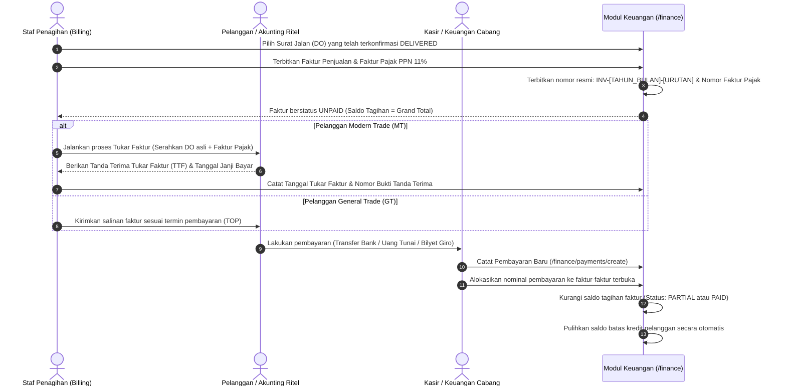

# Dokumen Proses Bisnis 07: Keuangan, Faktur Pajak, Piutang & Pembayaran

Dokumen ini menjelaskan alur penagihan piutang dagang (*Account Receivable / AR*), penerbitan Faktur Penjualan komersial beserta Faktur Pajak PPN 11%, prosedur Tukar Faktur bagi jaringan ritel modern, analisis jadwal umur piutang (*AR Aging*), metode penerimaan pembayaran kas/bank/giro, hingga rekonsiliasi dan pemulihan batas kredit pelanggan.

---

## 1. Alur Penagihan & Pelunasan Piutang Dagang



---

## 2. Penerbitan Faktur Penjualan (*Sales Invoice*) & Faktur Pajak
- **Rute Web**: `/finance/invoices/create` & `/finance/invoices/{id}`
- **Prasyarat**: Dokumen Surat Jalan (*Delivery Order*) asal harus sudah berstatus **Terkirim (*DELIVERED*)**.
- **Komponen Perhitungan Faktur**:
  1. **Nilai Dasar Pengenaan Pajak (DPP)**: Total nilai barang setelah dikurangi diskon langsung pada faktur.
  2. **Pajak Pertambahan Nilai (PPN 11%)**:
     $$\text{PPN 11\%} = \text{DPP} \times 11\%$$
  3. **Total Tagihan (*Grand Total*)**:
     $$\text{Grand Total} = \text{DPP} + \text{PPN 11\%}$$
  4. **Nomor Seri Faktur Pajak (NSFP)**: Diterbitkan dengan format standar perpajakan nasional (Contoh: `010.000-26.12345678`).
  5. **Tanggal Jatuh Tempo (*Due Date*)**: Dihitung otomatis dari Tanggal Faktur ditambah masa kredit pelanggan (*Term of Payment*).

---

## 3. Prosedur Tukar Faktur Ritel Modern (*Invoice Exchange*)

Bagi jaringan supermarket dan hypermarket, penghitungan jatuh tempo pembayaran **tidak dimulai dari tanggal barang tiba**, melainkan dimulai dari **tanggal dokumen faktur resmi diserahkan dan dinyatakan lengkap** oleh bagian akunting ritel (*Tukar Faktur*):

| Dokumen Wajib Tukar Faktur | Kriteria Pemeriksaan oleh Bagian Ritel |
| :--- | :--- |
| **Surat Jalan Asli Lembar Kedua** | Wajib memiliki tanda tangan basah penerima toko, tanggal penerimaan, dan stempel basah gerai supermarket. |
| **Faktur Penjualan Komersial Asli** | Mencantumkan nomor Purchase Order (PO) supermarket yang sesuai tanpa selisih harga. |
| **Faktur Pajak Standar Elektronik** | Mencantumkan NPWP dan nama badan usaha ritel yang sah. |
| **Tanda Terima Faktur (TTF)** | Setelah dokumen lengkap diterima, staf ritel menerbitkan TTF yang mencantumkan tanggal rencana transfer pembayaran. |

---

## 4. Analisis & Pemantauan Umur Piutang (*AR Aging Schedule*)
- **Rute Web**: `/finance` & `/finance/ar-aging/export`
- Sistem mengelompokkan seluruh piutang terbuka pelanggan ke dalam 4 ember waktu (*aging buckets*) berdasarkan selisih antara hari ini dengan tanggal jatuh tempo faktur:

```
                  PEMANTAUAN KESEHATAN PIUTANG (AR AGING)
  ┌────────────────────────────────────────────────────────────────────────┐
  │ 1. LANCAR / CURRENT (0 s/d 30 Hari)                                    │
  │    Faktur belum jatuh tempo atau baru terbit dalam 30 hari terakhir.   │
  │    Tindakan: Penagihan rutin standar.                                  │
  ├────────────────────────────────────────────────────────────────────────┤
  │ 2. PERHATIAN KHUSUS (31 s/d 60 Hari)                                   │
  │    Faktur telah melewati jatuh tempo s/d 1 bulan.                     │
  │    Tindakan: Pengiriman surat pengingat tagihan (Statement of Account). │
  ├────────────────────────────────────────────────────────────────────────┤
  │ 3. PERINGATAN KERAS (61 s/d 90 Hari)                                   │
  │    Faktur menunggak lebih dari 2 bulan.                                │
  │    Tindakan: Kunjungan khusus kolektor; pesanan baru ditahan otomatis. │
  ├────────────────────────────────────────────────────────────────────────┤
  │ 4. PIUTANG KRITIS / MACET (> 90 Hari)                                  │
  │    Faktur menunggak lebih dari 3 bulan.                                │
  │    Tindakan: Penghentian pasokan total (*Stop Delivery*); jalur hukum. │
  └────────────────────────────────────────────────────────────────────────┘
```

---

## 5. Penerimaan Pembayaran & Alokasi Pelunasan
- **Rute Web**: `/finance/payments/create`
- **Metode Pembayaran yang Didukung**:
  1. **Transfer Bank**: Pencatatan mutasi rekening bank resmi perusahaan (BCA, Mandiri, BRI, BNI) beserta nomor referensi bukti transfer.
  2. **Uang Tunai (*Cash*)**: Penerimaan setoran kas dari supir kanvas atau pembayaran tunai toko di kasir cabang.
  3. **Bilyet Giro / Cek Mundur**: Pencatatan nomor giro, bank penerbit, dan **Tanggal Jatuh Tempo Giro (*Giro Due Date*)**. Giro yang belum jatuh tempo berstatus `PENDING_CLEARING` dan belum memotong saldo piutang sampai dana benar-benar efektif masuk ke rekening koran (*Cleared*).

### Metode Alokasi Pembayaran ke Faktur Terbuka:
- Saat mencatat pembayaran, kasir dapat mengalokasikan nominal uang ke satu atau beberapa faktur terbuka milik pelanggan tersebut.
- Jika alokasi melunasi seluruh saldo faktur, status faktur otomatis berubah menjadi **LUNAS (*PAID*)**.
- Jika alokasi baru mencakup sebagian nilai faktur, status faktur berubah menjadi **DIBAYAR SEBAGIAN (*PARTIAL*)** dan saldo tagihan berkurang sebesar nominal alokasi.

---

## 6. Pemulihan Otomatis Plafon Batas Kredit Pelanggan

Begitu pembayaran tercatat dan tervalidasi di sistem:
1. Akumulasi kredit terpakai (`current_credit_used`) pada profil pelanggan otomatis berkurang sebesar nominal pembayaran pokok:
   $$\text{Kredit Terpakai Baru} = \text{Kredit Terpakai Lama} - \text{Nominal Pelunasan}$$
2. Sisa batas kredit pelanggan seketika pulih (*real-time recovery*).
3. Toko pelanggan dapat segera melakukan pesanan penjualan berikutnya tanpa terhambat batasan limit kredit.

