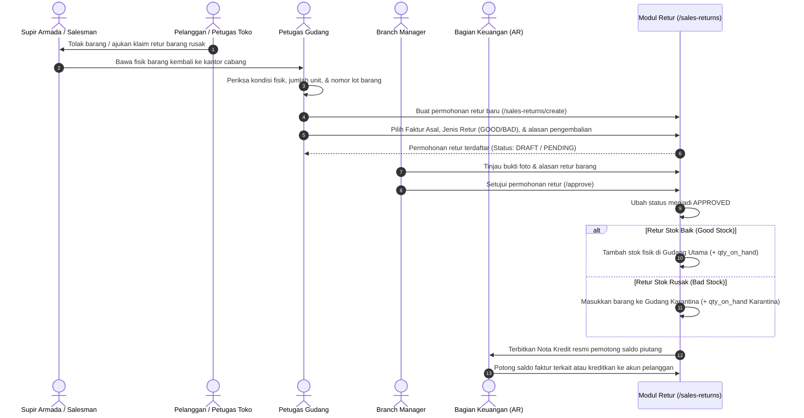

# Dokumen Proses Bisnis 08: Pengembalian Barang, Retur & Gudang Karantina

Dokumen ini menjelaskan alur pengembalian barang (*Sales Return*), pembedaan perlakuan antara stok kondisi baik (*Good Stock*) dan stok rusak (*Bad Stock*), tata kelola Gudang Karantina, serta penerbitan Nota Kredit (*Credit Note*) untuk penyesuaian saldo tagihan pelanggan.

---

## 1. Klasifikasi Jenis Retur Penjualan

Dalam bisnis distribusi konsumen, tidak semua pengembalian barang diperlakukan sama:

```
                         PENGEMBALIAN BARANG DARI PELANGGAN
                                         │
                 ┌───────────────────────┴───────────────────────┐
                 ▼                                               ▼
   ┌───────────────────────────┐                   ┌───────────────────────────┐
   │ RETUR STOK BAIK           │                   │ RETUR STOK RUSAK          │
   │ (GOOD STOCK)              │                   │ (BAD STOCK)               │
   ├───────────────────────────┤                   ├───────────────────────────┤
   │ Penyebab:                 │                   │ Penyebab:                 │
   │ • Salah kirim varian SKU  │                   │ • Kemasan bocor / penyok  │
   │ • Kelebihan kuantitas     │                   │ • Rusak saat transportasi │
   │ • Toko tutup saat kirim   │                   │ • Kedaluwarsa di toko     │
   ├───────────────────────────┤                   ├───────────────────────────┤
   │ Tindakan Fisik:           │                   │ Tindakan Fisik:           │
   │ Masuk kembali ke Rak Stok │                   │ Masuk ke GUDANG KARANTINA │
   │ Utama (Siap Dijual Ulang) │                   │ (Terisolasi dari penjualan│
   └───────────────────────────┘                   └───────────────────────────┘
```

---

## 2. Alur Operasional Retur Penjualan



---

## 3. Rincian Prosedur Pengembalian Barang

### A. Pengajuan Retur Penjualan
- **Rute Web**: `/sales-returns/create` & `/sales-returns`
- **Data yang Wajib Dilengkapi**:
  1. Identitas pelanggan yang mengembalikan barang.
  2. Nomor faktur penjualan atau nomor surat jalan rujukan.
  3. Gudang penampung (Gudang Utama untuk stok baik, atau Gudang Karantina untuk stok rusak).
  4. Rincian produk, satuan, nomor batch, kuantitas, dan harga satuan asal.
  5. **Alasan Pengembalian**: Pilihan alasan baku (*Barang Cacat dari Pabrik*, *Rusak dalam Pengiriman*, *Kelebihan Kirim*, atau *Mendekati Kedaluwarsa*).
  6. Catatan keterangan tambahan.

### B. Otorisasi & Persetujuan Retur
- Setiap permohonan retur melibatkan nilai finansial yang mengurangi omset cabang.
- Branch Manager atau Superadmin wajib meninjau permohonan retur sebelum disetujui.
- Persetujuan ini memicu pembaruan sistem secara ganda: penambahan persediaan fisik dan penerbitan nota kredit keuangan.

---

## 4. Tata Kelola Gudang Karantina (*Quarantine Management*)

Gudang Karantina adalah zona isolasi fisik dan logis yang memiliki peran krusial:
1. **Pencegahan Kontaminasi Stok**: Barang yang rusak, bocor, atau kedaluwarsa **tidak boleh tercampur** dengan barang di gudang utama agar tidak terambil kembali saat ada pesanan penjualan baru.
2. **Klaim Penggantian ke Pabrik (*Principal Claim*)**:
   - Seluruh barang di gudang karantina dikumpulkan secara berkala (misal: akhir bulan).
   - Dibuatkan Berita Acara Kerusakan Barang (*Damage Goods Report*).
   - Dokumen ini dikirimkan ke pabrik produsen (*Principal*) untuk mendapatkan barang pengganti (*Replacement*) atau pemotongan tagihan pembelian (*Debit Note*).
3. **Pemusnahan Barang (*Scrapping*)**:
   - Jika barang rusak tidak dapat diklaim ke pabrik, barang akan dimusnahkan secara resmi dengan dihadiri saksi dari perwakilan manajemen dan dibuatkan Berita Acara Pemusnahan Barang.

---

## 5. Dampak Keuangan & Nota Kredit (*Credit Note*)

Persetujuan retur penjualan secara otomatis memengaruhi aspek keuangan:
1. **Pengurangan Saldo Piutang Faktur Asal**:
   - Jika faktur rujukan belum lunas, nilai retur otomatis memotong saldo tagihan faktur tersebut (`balance_due`).
   - Contoh: Faktur sebesar Rp 10.000.000 diretur sebesar Rp 1.500.000, maka saldo tagihan tersisa menjadi Rp 8.500.000.
2. **Penerbitan Saldo Deposit Pelanggan**:
   - Jika faktur rujukan sudah lunas, nilai retur dicatat sebagai saldo deposit (*credit balance*) pelanggan yang dapat digunakan sebagai pengurang tagihan pada pesanan berikutnya.
3. **Pemulihan Batas Kredit**:
   - Nilai retur langsung mengurangi nilai kredit terpakai (`current_credit_used`), sehingga sisa plafon kredit pelanggan kembali meningkat.

