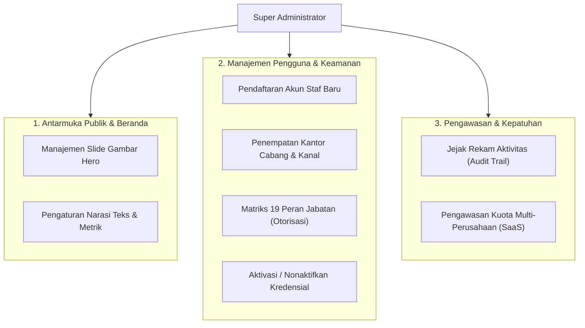

# Dokumen Proses Bisnis 09: Pengaturan Beranda, Hak Akses & Tata Kelola Sistem

Dokumen ini menjelaskan tata kelola administrasi sistem, mencakup pengelolaan konten halaman beranda publik (*Landing Page CMS*), manajemen pengguna dan cabang, penerapan matriks 19 peran jabatan (*Role & Permission Matrix*), pencatatan jejak audit (*Audit Trail*), serta pengawasan kuota platform multi-perusahaan.

---

## 1. Peta Tata Kelola Administrasi Sistem

---

## 2. Pengelolaan Halaman Beranda (*Landing Page CMS*)
- **Rute Web**: `/landing-settings`
- **Tujuan**: Memungkinkan administrator memperbarui tampilan citra perusahaan di halaman beranda utama (`/`) tanpa perlu mengubah kode sumber perangkat lunak.

### A. Manajemen Slide Gambar Latar Belakang (*Hero Slideshow*)
1. **Tambah Slide Baru**:
   - Memasukkan Judul Utama (Contoh: *"Pusat Distribusi Modern & Multi-Gudang"*).
   - Memasukkan Subjudul Penjelas.
   - Memasukkan Teks Lencana Kategori (*Badge Text*, misal: *"Gudang & Logistik"*).
   - Menautkan Tautan Gambar resolusi tinggi atau mengunggah berkas gambar.
   - Menentukan Teks Tombol Aksi (*CTA Text*) dan Tautan Tujuan (*CTA Link*).
   - Menentukan Nomor Urut Tampil (*Sort Order*).
2. **Ubah & Atur Urutan Slide**: Memperbarui teks atau urutan slide yang sedang aktif.
3. **Toggle Aktif / Nonaktif**: Mengistirahatkan slide musiman (misal: slide promo Idul Fitri) tanpa menghapus datanya dari sistem.
4. **Hapus Slide**: Menghapus slide secara permanen dari basis data.

### B. Pengaturan Konten Narasi & Metrik Statistik
- Memperbarui teks pembuka utama (*Hero Title* & *Subtitle*).
- Menyesuaikan angka-angka metrik pembuktian (Contoh: *Tingkat Kepuasan Toko 99,8%*, *Armada Siap Jalan 150+ Unit*).

---

## 3. Manajemen Pengguna & Kredensial Staf
- **Rute Web**: `/users`
- **Fitur Utama**:
  1. **Tambah Staf Baru (`/users` via POST)**:
     - Nama Lengkap dan Alamat Email resmi kantor.
     - Kata sandi awal (yang dapat diperbarui secara mandiri oleh staf).
     - **Penempatan Cabang**: Menentukan di kantor cabang mana staf tersebut bertugas (Pusat, Jakarta, Bandung, Surabaya).
     - **Tugas Saluran**: Membatasi cakupan saluran staf (`GT`, `MT`, atau `ALL`).
     - **Peran Fungsional**: Memilih jabatan kerja (Branch Manager, Sales Admin, KAM MT, Salesman GT, Warehouse Keeper, Finance, dll).
  2. **Nonaktifkan Kredensial Seketika (`/users/{id}/toggle-status`)**:
     - Jika staf mengundurkan diri atau dimutasi, akun dapat dinonaktifkan dengan satu klik.
     - Akun nonaktif seketika kehilangan hak akses login ke dalam sistem demi mencegah kebocoran informasi internal.

---

## 4. Matriks 19 Peran Jabatan & Otorisasi Akses Minimum

Sistem menerapkan prinsip keamanan **Hak Akses Terbatas Sesuai Kebutuhan Tugas (*Principle of Least Privilege*)** melalui 19 profil peran kerja terstandarisasi:

| Kelompok Peran | Daftar Jabatan Fungsional | Cakupan Batasan Hak Akses |
| :--- | :--- | :--- |
| **Pimpinan & Pengawasan** | • Super Administrator • Executive Director / BoD • Branch Manager | Akses laporan konsolidasi nasional, persetujuan dispensasi limit kredit, dan pengawasan kuota. |
| **Penjualan & Pemasaran** | • Sales Administrator • Key Account Manager (KAM MT) • Sales Supervisor • Salesman Taking Order (GT) • Salesman Kanvas Mobil (GT) | Pembuatan pesanan, rute kunjungan, dan katalog penawaran harga. Dilarang mengubah stok fisik gudang atau posting penyesuaian opname. |
| **Logistik & Pergudangan** | • Warehouse Manager • Kepala Gudang Cabang • Staff Picking & Packer • Admin Ekspedisi & Supir | Penerbitan surat jalan, transfer antar-gudang, dan penghitungan stok fisik. Dilarang menerbitkan faktur pajak atau menerima pembayaran uang. |
| **Keuangan & Penagihan** | • Finance Controller HO • Staff Faktur & Pajak (Billing) • Kasir Cabang • Kolektor Piutang (AR Debt Collector) | Penerbitan faktur, pencatatan bukti bayar kas/bank/giro, dan nota kredit retur. Dilarang menghapus rekor transaksi yang sudah diposting. |
| **Audit & Kepatuhan** | • Internal Auditor • Inventory Controller | Akses baca (*read-only*) seluruh buku besar mutasi stok, kartu piutang, dan jejak aktivitas sistem. |

---

## 5. Jejak Rekam Transaksi & Audit Log (*Audit Trail*)
- **Rute Web**: `/audit-logs`
- **Karakteristik Jejak Audit**:
  1. **Pencatatan Otomatis**: Setiap aksi penting (perubahan data pelanggan, persetujuan pesanan dengan dispensasi, penyesuaian stok opname, penerbitan faktur pajak) otomatis tercatat di sistem log.
  2. **Informasi yang Direkam**: Identitas Pengguna (*User ID* & Nama), Alamat IP, Waktu Kejadian (*Timestamp*), Modul yang Diakses, Aksi yang Dilakukan (*CREATE / UPDATE / DELETE / APPROVE*), serta nilai data sebelum dan sesudah perubahan.
  3. **Keamanan Log**: Catatan audit bersifat permanen dan tidak dapat diedit atau dimanipulasi oleh siapapun guna mendukung kebutuhan audit investigatif.

---

## 6. Pengawasan Kuota Platform Multi-Perusahaan (*SaaS Platform Control*)
- **Rute Web**: `/superadmin/dashboard` & `/superadmin/tenants`
- **Tujuan**: Memfasilitasi pemilik platform perangkat lunak (*Software Owner*) untuk memantau penggunaan sistem oleh masing-masing perusahaan penyewa (*tenants*).
- **Pengaturan Kuota Batas Pemakaian**:
  - **Maksimal Jumlah Pengguna Aktif (*Max Users*)**: Mencegah pemakaian melebihi paket lisensi yang dibayarkan.
  - **Maksimal Kantor Cabang (*Max Branches*)**: Membatasi ekspansi cabang sesuai paket langganan.
  - **Maksimal Gudang Logistik (*Max Warehouses*)**: Mengatur jumlah titik fasilitas gudang aktif.
- **Isolasi Data Bertingkat**: Data transaksi antar perusahaan terisolasi total, memastikan kerahasiaan portofolio pelanggan dan omset antar entitas bisnis terjaga 100%.

