# Dokumen Proses Bisnis 10: Standar Operasional Prosedur (SOP) Harian & Penutupan Buku

Dokumen ini memuat Standar Operasional Prosedur (*Standard Operating Procedure / SOP*) harian bagi seluruh divisi kerja di kantor cabang distributor. Dokumen ini mengatur jadwal rutinitas kerja mulai dari jam buka operasional pagi (*Morning Routine*), aktivitas lapangan siang hari, serah terima dan rekonsiliasi kasir sore hari (*End of Day / EOD*), hingga penutupan buku bulanan (*End of Month / EOM*).

---

## 1. Garis Waktu Operasional Harian Kantor Cabang

```
 07:00 - 08:30           08:30 - 16:00           16:00 - 18:30           18:30 - 19:30
┌─────────────────────┐ ┌─────────────────────┐ ┌─────────────────────┐ ┌─────────────────────┐
│ 1. RUTINITAS PAGI   │ │ 2. OPERASI SIANG    │ │ 3. REKONSILIASI SORE│ │ 4. TUTUP HARI (EOD) │
│ • Morning Briefing  │ │ • Kunjungan Toko TO │ │ • Setor Uang Tunai  │ │ • Cek Status Transaksi│
│ • Muat Truk Logistik│ │ • Van Kanvas Keliling│ │ • Rekonsiliasi Giro │ │ • Kunci Buku Kasir  │
│ • Muat Mobil Kanvas │ │ • Pengiriman Armada │ │ • Kembalikan Sisa DO│ │ • Jadwal Rute Esok  │
│ • Unduh Rute Harian │ │ • Penagihan Piutang │ │ • Cek Fisik Mobil   │ │ • Laporan Harian BM │
└─────────────────────┘ └─────────────────────┘ └─────────────────────┘ └─────────────────────┘
```

---

## 2. SOP 1: Rutinitas Buka Operasional Pagi Hari (*Morning Routine*)
- **Penanggung Jawab**: Branch Manager, Kepala Gudang, Sales Supervisor.
- **Waktu Pelaksanaan**: Pukul 07.00 - 08.30 WIB.
- **Tahapan Prosedur**:
  1. **Briefing Pagi Tim Penjual (07.00 - 07.30 WIB)**:
     - Sales Supervisor memimpin doa dan menyampaikan fokus produk prioritas harian.
     - Mengevaluasi pencapaian target mingguan dan mengingatkan toko pelanggan yang memiliki tagihan jatuh tempo.
     - Salesman Taking Order memeriksa rute kunjungan harian (*Beat Plan*) pada menu `/routes`.
  2. **Pemeriksaan Muatan Armada Truk Pengiriman (07.00 - 08.00 WIB)**:
     - Kepala Gudang menyerahkan Surat Jalan cetak 3 rangkap kepada masing-masing supir pengiriman.
     - Supir memeriksa kesesuaian fisik muatan di bak truk dengan lembar Surat Jalan.
     - Supir menandatangani buku ekspedisi pengeluaran barang dan berangkat menuju rute pengiriman.
  3. **Pemuatan Stok Mobil Kanvas (07.30 - 08.30 WIB)**:
     - Salesman Kanvas mengajukan transfer stok muatan van harian dari Gudang Utama ke Gudang Mobil Kanvas terkait.
     - Petugas gudang memverifikasi nomor batch dan kuantitas barang sebelum dimasukkan ke dalam boks mobil.

---

## 3. SOP 2: Operasional Lapangan Siang Hari (*Field Operations*)
- **Penanggung Jawab**: Salesman TO, Salesman Kanvas, Supir Armada, Kolektor Piutang.
- **Waktu Pelaksanaan**: Pukul 08.30 - 16.00 WIB.
- **Tahapan Prosedur**:
  1. **Aktivitas Salesman Taking Order (TO)**:
     - Wajib mengunjungi seluruh toko pelanggan yang terjadwal pada hari tersebut (target minimal 20 - 25 toko/hari).
     - Memeriksa stok barang di etalase toko dan mengecek tanggal kedaluwarsa.
     - Menginput pesanan baru melalui antarmuka Sales Order.
  2. **Aktivitas Pengiriman Armada Logistik**:
     - Mengantar pesanan ke alamat toko atau distribution center supermarket tepat waktu.
     - Meminta tanda tangan, nama terang, dan stempel basah toko pada Surat Jalan rangkap asli dan lembar penagihan.
     - Jika toko menolak sebagian barang karena rusak, supir mencatat pada kolom catatan serah terima dan membawa pulang barang yang ditolak.
  3. **Aktivitas Kolektor Piutang (AR Debt Collector)**:
     - Mengunjungi pelanggan yang masuk kategori umur piutang 31 - 60 hari.
     - Mengumpulkan pembayaran cek/giro atau uang tunai dan menyerahkan tanda terima resmi.

---

## 4. SOP 3: Serah Terima & Rekonsiliasi Sore Hari (*End of Day Reconciliation*)
- **Penanggung Jawab**: Kasir Cabang, Kepala Gudang, Sales Administrator.
- **Waktu Pelaksanaan**: Pukul 16.00 - 18.30 WIB.

```mermaid
flowchart TD
    subgraph A["Rekonsiliasi Supir Armada"]
        A1["Supir Kembali ke Cabang"] --> A2["Serahkan Lembar Surat Jalan (POD) Bertandatangan"]
        A2 --> A3["Admin Input Konfirmasi Terima (/deliver)"]
        A3 --> A4["Faktur Siap Terbit"]
    end

    subgraph B["Rekonsiliasi Salesman Kanvas"]
        B1["Mobil Kanvas Tiba di Cabang"] --> B2["Hitung Sisa Fisik Barang di Mobil"]
        B2 --> B3["Bandingkan: Stok Awal - Penjualan = Sisa Fisik"]
        B3 --> B4["Setor Uang Tunai Hasil Penjualan ke Kasir"]
    end

    subgraph C["Rekonsiliasi Kasir & Keuangan"]
        C1["Kasir Hitung Total Uang Tunai & Bilyet Giro Diterima"] --> C2["Input Pembayaran di Sistem (/payments/create)"]
        C2 --> C3["Alokasikan Pembayaran ke Faktur Terbuka"]
        C3 --> C4["Cetak Rekap Kasir Harian & Simpan Uang di Brankas"]
    end
```



### Aturan Ketat Kasir Cabang:
- Uang tunai hasil tagihan dilarang dibawa pulang oleh tenaga penjual atau supir.
- Seluruh uang tunai wajib disetorkan ke brankas cabang dan dihitung bersama antara penyetor dan kasir.
- Selisih kas (kurang setor) menjadi tanggung jawab pribadi penyetor dan dicatat dalam formulir Berita Acara Selisih Kasir.

---

## 5. SOP 4: Penutupan Harian Sistem (*Day-End Lock*)
- **Penanggung Jawab**: Branch Manager & Sales Administrator.
- **Waktu Pelaksanaan**: Pukul 18.30 - 19.30 WIB.
- **Daftar Periksa Penutupan (*Closing Checklist*)**:
  1. Memastikan tidak ada Sales Order yang tertinggal dalam status gantung tanpa kejelasan.
  2. Memastikan seluruh Surat Jalan yang telah terkirim sudah diperbarui statusnya menjadi **Terkirim (*DELIVERED*)**.
  3. Memastikan seluruh uang setoran kasir telah tercatat pada modul penerimaan pembayaran (`/finance/payments`).
  4. Meninjau antrean persetujuan pada menu `/sales-approvals` agar pesanan untuk pengiriman besok pagi sudah disetujui pimpinan.
  5. Mengunduh laporan rekapitulasi harian untuk ditandatangani oleh Branch Manager.

---

## 6. SOP 5: Prosedur Tutup Buku Bulanan (*End of Month Closing / EOM*)
- **Penanggung Jawab**: Branch Manager, Finance Controller HO, dan Internal Auditor.
- **Waktu Pelaksanaan**: Hari kerja terakhir setiap akhir bulan.
- **Tahapan Prosedur**:
  1. **Stock Opname Menyeluruh**: Menghentikan pergerakan barang (*Cut-off*) selama 1 hari untuk menghitung seluruh fisik barang di gudang utama, gudang karantina, dan gudang kanvas.
  2. **Rekonsiliasi Piutang Pelanggan**: Mengirimkan Surat Konfirmasi Piutang (*Statement of Account / SOA*) kepada 50 pelanggan terbesar untuk mencocokkan saldo utang-piutang.
  3. **Penyesuaian Biaya Kontrak MTA**: Menghitung akumulasi omset pelanggan Modern Trade dan mencadangkan biaya rabat tahunan (*Rebate Provision*).
  4. **Penguncian Periode Akuntansi**: Memastikan tidak ada transaksi bertanggal mundur (*backdated*) yang dapat dimasukkan setelah periode resmi ditutup.

