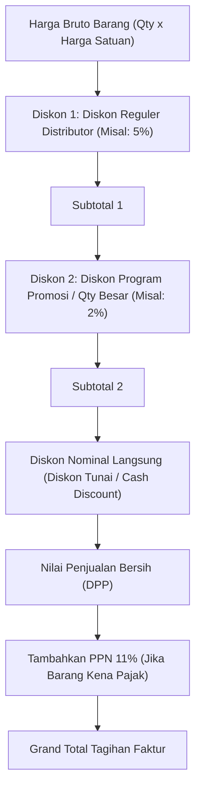

# Dokumen Proses Bisnis 11: Katalog Produk, Multi-Satuan Kemasan & Promosi Dagang

Dokumen ini menjelaskan struktur data induk produk (*product master*), arsitektur multi-satuan kemasan (*Unit of Measure / UOM*), rumus konversi kuantitas stok otomatis, standardisasi biaya pokok penjualan (*Standard COGS*), serta skema diskon dan program promosi dagang.

---

## 1. Hirarki Struktur Data Produk

Setiap produk dalam sistem diorganisasikan ke dalam tingkatan klasifikasi bisnis yang jelas:

```
                          ┌────────────────────────────┐
                          │     KATEGORI PRODUK        │
                          │   (Beverages, Foods, dll)  │
                          └──────────────┬─────────────┘
                                         │
                                         ▼
                          ┌────────────────────────────┐
                          │   MASTER BARANG (SKU)      │
                          │ Kopi Susu Aren 200ml Botol │
                          │ Base UOM: BOTOL (Terkecil) │
                          └──────────────┬─────────────┘
                                         │
                 ┌───────────────────────┴───────────────────────┐
                 ▼                                               ▼
   ┌───────────────────────────┐                   ┌───────────────────────────┐
   │ SATUAN KARTON / DUS       │                   │ SATUAN PAK / SLOP         │
   │ Faktor Konversi: 24       │                   │ Faktor Konversi: 6        │
   │ 1 Karton = 24 Botol       │                   │ 1 Pak = 6 Botol           │
   └───────────────────────────┘                   └───────────────────────────┘
```

---

## 2. Arsitektur Multi-Satuan Kemasan (*Multi-UOM Engine*)

Dalam distribusi FMCG, produsen menjual dalam kemasan besar (Karton/Koli), grosir membeli dalam satuan Karton atau Pak, sedangkan warung atau toko eceran seringkali membeli dalam satuan renceng, pak kecil, atau satuan botol/pcs.

### Aturan Konversi Satuan:
1. **Satuan Terkecil (*Base UOM*)**:
   - Seluruh mutasi persediaan fisik di gudang, kartu stok, dan buku besar disimpan dalam **Satuan Dasar Terkecil** (misalnya `PCS` atau `BOTOL`).
   - Hal ini memastikan tidak ada pembulatan desimal yang hilang (*zero fractional loss*).
2. **Faktor Konversi (*Conversion Factor*)**:
   - Menggambarkan berapa banyak satuan dasar yang terkandung dalam satu satuan kemasan yang lebih besar:
     $$\text{Kuantitas Satuan Dasar} = \text{Kuantitas Dipesan} \times \text{Faktor Konversi}$$
   - Contoh:
     - Pelanggan memesan **5 Karton** Kopi Susu Aren (Faktor = 24).
     - Sistem mencatat pesanan 5 Karton, namun mencadangkan stok sebesar:
       $$5 \times 24 = 120\text{ Botol}$$

---

## 3. Komponen Biaya Pokok (COGS) & Perpajakan

| Atribut Finansial Produk | Penjelasan & Fungsi Bisnis |
| :--- | :--- |
| **Harga Pokok Standar (*Standard COGS*)** | Estimasi nilai biaya modal pembelian barang dari pabrik per satuan dasar (Contoh: Rp 15.000/botol). Digunakan untuk menghitung nilai valuasi stok gudang dan batas minimal keuntungan (*profit margin*). |
| **Tipe Perlakuan Pajak (*Tax Type*)** | Menentukan apakah produk dikenai PPN: `TAXABLE_11` (Kena PPN 11%) atau `NON_TAXABLE` (Bebas PPN untuk barang kebutuhan pokok tertentu seperti beras dan telur). |
| **Dasar Pengenaan Pajak (DPP)** | Nilai penjualan bersih setelah dipotong seluruh diskon langsung. Nilai PPN dihitung sebesar $11\% \times \text{DPP}$. |

---

## 4. Skema Diskon Berjenjang & Potongan Harga

Sistem mendukung skema diskon bertingkat yang lazim diterapkan oleh prinsipal dan distributor nasional:



### Rumus Kalkulasi Diskon Berjenjang:
$$\text{Subtotal 1} = \text{Harga Bruto} - (\text{Harga Bruto} \times \text{Diskon 1}\%)$$
$$\text{Subtotal 2} = \text{Subtotal 1} - (\text{Subtotal 1} \times \text{Diskon 2}\%)$$
$$\text{DPP} = \text{Subtotal 2} - \text{Diskon Nominal}$$

---

## 5. Klasifikasi Diskon: Di Dalam Faktur vs Di Luar Faktur

Distributor membedakan dengan tegas dua jenis diskon:

1. **Diskon Di Dalam Faktur (*On-Invoice Discount*)**:
   - Tercantum langsung pada cetakan formulir Sales Order dan Faktur Penjualan.
   - Mengurangi secara langsung nilai Dasar Pengenaan Pajak (DPP) dan nilai piutang yang wajib dibayar toko.
   - Contoh: Diskon kuantitas beli 10 dus dapat potongan 3%, diskon pembayaran tunai di tempat 1%.
2. **Potongan Rabat Di Luar Faktur (*Off-Invoice Rebate*)**:
   - **Tidak mengurangi** nilai tagihan faktur saat barang dikirim.
   - Nilai faktur tetap ditagih secara penuh (100%).
   - Rabat diakumulasikan selama periode tertentu (triwulan atau tahunan) dan dibayarkan kembali kepada toko atau supermarket melalui Nota Kredit atau transfer insentif jika toko berhasil mencapai target volume penjualan (*Target Rebate*).

---

## 6. Kebijakan Barang Bonus Promosi (*Free Goods / Beli X Gratis Y*)

Dalam program promosi tertentu, produsen memberikan insentif berupa barang gratis (misal: *Beli 10 Karton Kopi Gratis 1 Karton*):

1. **Pengeluaran Fisik Barang Bonus**:
   - Barang bonus tetap wajib diterbitkan Surat Jalan resmi agar supir dapat menyerahkannya secara sah kepada toko.
   - Stok barang bonus di gudang berkurang secara riil dan dicatat mutasinya di Buku Besar Stok.
2. **Perlakuan Nilai Faktur Barang Bonus**:
   - Pada baris faktur penjualan, barang bonus dicantumkan dengan keterangan *"PROMO GRATIS"* dengan harga satuan Rp 0 atau diskon 100%.
   - Pajak pertambahan nilai atas barang cuma-cuma dapat ditanggung oleh perusahaan distributor atau dibebankan sesuai regulasi perpajakan yang berlaku.

