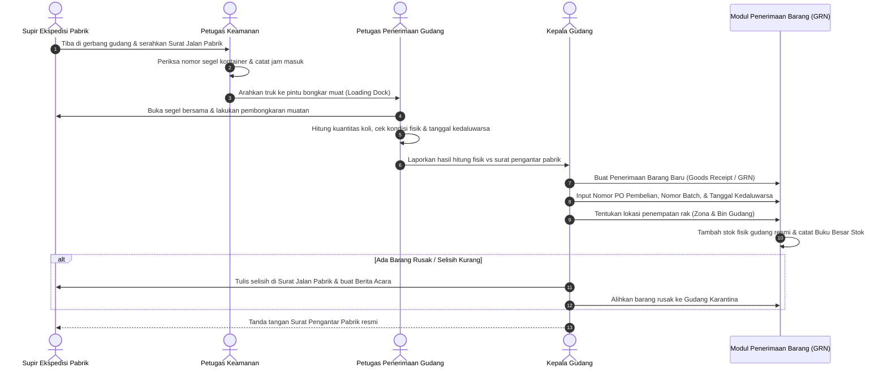
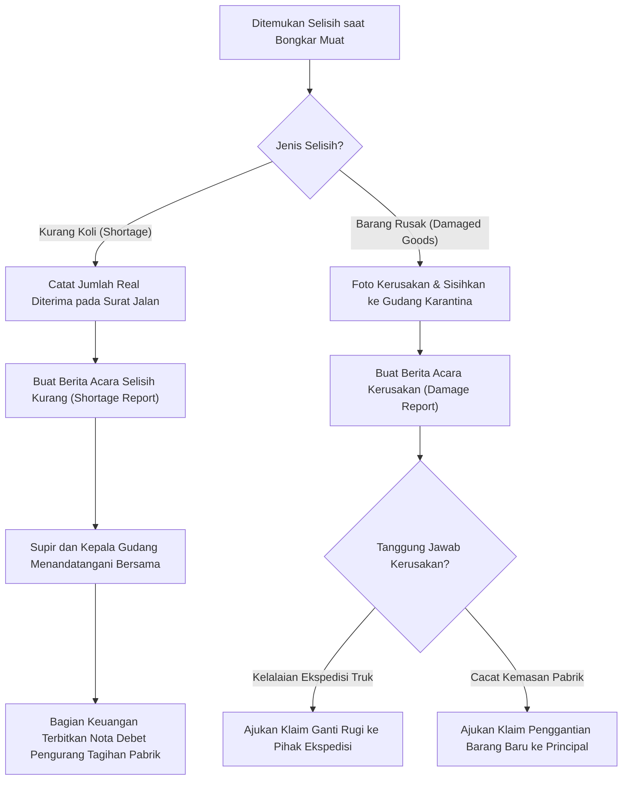

# Dokumen Proses Bisnis 12: Logistik Masuk & Penerimaan Barang dari Principal

Dokumen ini menjelaskan alur operasional logistik masuk (*Inbound Logistics*), yaitu proses penerimaan barang dagangan dari pabrik produsen (*Principal*), pemeriksaan fisik dan penjaminan mutu barang, registrasi nomor lot/batch dan tanggal kedaluwarsa, penataan pada zona dan rak gudang (*Warehouse Bins*), serta penanganan selisih dan klaim kerusakan barang masuk.

---

## 1. Siklus Penerimaan Barang Masuk (*Inbound Lifecycle*)



---

## 2. Standar Pemeriksaan Fisik Barang Masuk (*Receiving Inspection*)

Penerimaan barang dari pabrik wajib memenuhi kriteria pemeriksaan ketat:

1. **Integritas Segel Pengiriman**:
   - Nomor segel fisik pada pintu kontainer atau boks truk wajib dicocokkan dengan nomor segel yang tertulis pada dokumen jalan pabrik.
   - Jika segel rusak atau tidak sesuai, pembongkaran ditunda dan dibuatkan dokumentasi foto sebelum disaksikan supir.
2. **Kesesuaian Masa Simpan (*Shelf-Life Verification*)**:
   - Tanggal kedaluwarsa yang tercetak pada kemasan luar karton dan satuan dasar wajib dicatat secara cermat.
   - **Batas Toleransi Minimal**: Gudang distributor menolak penerimaan barang baru jika sisa masa simpannya kurang dari 80% dari total umur produk pabrik (*Fresh Goods Guarantee*).
3. **Kondisi Fisik Kemasan**:
   - Pemeriksaan terhadap karton basah, sobek, penyok akibat tumpukan terlalu tinggi, atau indikasi serangan hama.
   - Barang yang rusak fisik langsung dipisahkan di area penerimaan sementara dan tidak boleh dimasukkan ke rak stok siap jual.

---

## 3. Penataan Ruang Gudang: Zona & Rak Bin (*Warehouse Layout*)

Untuk mempermudah kecepatan pengambilan barang saat ada pesanan penjualan, gudang dikelompokkan ke dalam zona-zona terdefinisi:

```
                          TATA LETAK FASILITAS GUDANG
  ┌────────────────────────────────────────────────────────────────────────┐
  │ 1. PINTU BONGKAR MUAT (Inbound Dock)                                   │
  │    Area parkir truk pabrik, pembongkaran palet, dan pemeriksaan awal.  │
  ├────────────────────────────────────────────────────────────────────────┤
  │ 2. ZONA FAST-MOVING (Rak Tingkat Bawah - Jalur Cepat)                  │
  │    Produk dengan perputaran harian sangat tinggi (Air Mineral, Kopi,   │
  │    Mie Instan). Ditempatkan dekat pintu keluar untuk efisiensi picker. │
  ├────────────────────────────────────────────────────────────────────────┤
  │ 3. ZONA SLOW-MOVING / CADANGAN (Rak Palet Atas / High-Rack)           │
  │    Stok penyangga (*buffer stock*) untuk pemenuhan kebutuhan mingguan. │
  ├────────────────────────────────────────────────────────────────────────┤
  │ 4. ZONA BARANG BERHARGA TINGGI (High-Value / Controlled Cage)          │
  │    Area berpagar dan terkunci untuk produk mahal (Susu Bayi, Kosmetik).│
  ├────────────────────────────────────────────────────────────────────────┤
  │ 5. ZONA KARANTINA & RETUR RUSAK (Quarantine Holding Area)              │
  │    Area terpisah untuk barang rusak menunggu klaim penggantian pabrik. │
  └────────────────────────────────────────────────────────────────────────┘
```

---

## 4. Pencatatan Bukti Penerimaan Barang (*Goods Receipt Note / GRN*)

Pencatatan penerimaan barang di sistem menghasilkan bukti sah pengakuan persediaan:
- **Nomor Dokumen**: Format resmi otomatis (Contoh: `GRN-202610-0015`).
- **Atribut yang Dicatat**:
  1. Identitas Principal / Pemasok.
  2. Nomor Surat Jalan Pabrik dan Nomor Purchase Order (PO) Pembelian.
  3. Gudang Tujuan Penerimaan (Contoh: `WH-CKG` Cakung).
  4. Rincian SKU Barang, Jumlah Koli Diterima, Satuan Kemasan.
  5. **Nomor Lot / Batch Unik** dan **Tanggal Kedaluwarsa** yang melekat pada barang.
- **Efek Akuntansi & Persediaan**:
  - Saldo stok fisik bertambah seketika (`qty_on_hand`).
  - Rekor mutasi masuk bertambah pada Buku Besar Mutasi Stok (*Stock Ledger*).
  - Bagian Akuntansi Hutang (*Account Payable / AP*) dapat mencocokkan dokumen GRN dengan faktur tagihan dari pabrik produsen (*3-Way Matching*).

---

## 5. Penanganan Selisih Barang Masuk & Klaim Ekspedisi

Jika terjadi ketidaksesuaian antara dokumen jalan pabrik dengan fisik barang yang diterima di gudang:



Dengan prosedur ini, perusahaan distributor terhindar dari menanggung biaya kerugian atas barang yang rusak atau hilang sebelum resmi menjadi tanggung jawab gudang distributor.

