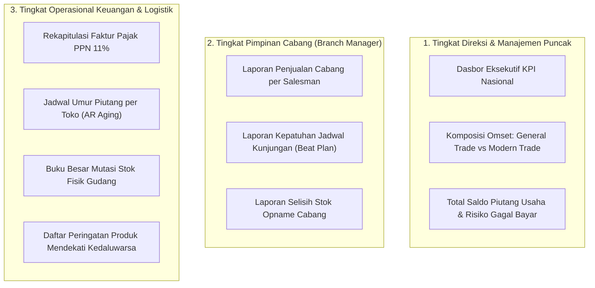

# Dokumen Proses Bisnis 13: Laporan Operasional, Analitik Penjualan & Ekspor Data

Dokumen ini menjelaskan katalog laporan resmi perusahaan, analisis kinerja penjualan dan distribusi, pemantauan kesehatan persediaan barang, laporan pengawasan umur piutang (*AR Aging*), serta fasilitas ekspor data terpadu untuk integrasi audit dan pembukuan akuntansi.

---

## 1. Ekosistem Pelaporan & Pengambilan Keputusan

Sistem menyediakan informasi yang disesuaikan dengan kebutuhan setiap jenjang manajemen:

---

## 2. Katalog Laporan Resmi & Ekspor Data

Sistem dilengkapi tombol ekspor berkas data resmi (format CSV standar) pada modul-modul utama untuk mempermudah analisis di aplikasi spreadsheet atau integrasi ke perangkat lunak akuntansi:

| Nama Laporan | Rute Menu & Unduhan | Penerima Manfaat Utama | Fungsi Bisnis |
| :--- | :--- | :--- | :--- |
| **Rekapitulasi Sales Order** | `/sales-orders-export` | Sales Manager & Direktur Operasional | Menganalisis volume pesanan harian/bulanan, tren penjualan per produk, status persetujuan, dan nilai omset kotor vs bersih. |
| **Buku Besar Mutasi Stok** | `/inventory/ledger/export` | Kepala Gudang & Auditor Persediaan | Memeriksa riwayat keluar-masuk barang secara kronologis, nomor batch, saldo awal, saldo akhir, dan dokumen rujukan. |
| **Jadwal Umur Piutang (AR Aging)** | `/finance/ar-aging/export` | Finance Controller & Kolektor Piutang | Mengelompokkan tagihan toko berdasarkan umur keterlambatan (0-30, 31-60, 61-90, >90 hari) guna menentukan prioritas penagihan. |
| **Peringatan Kedaluwarsa** | `/inventory/expiry-alerts` | Key Account Manager & Pengawas Gudang | Mengidentifikasi stok barang yang memiliki sisa masa simpan kurang dari 90 hari agar segera diprioritaskan penjualannya. |
| **Kinerja Target Salesman** | `/sales-targets` | Sales Supervisor & HRD | Mengukur pencapaian omset aktual terhadap target bulanan untuk penentuan bonus dan komisi kinerja. |

---

## 3. Rincian Metrik & Analisis Utama

### A. Analisis Komposisi Saluran Penjualan (*Channel Breakdown*)
- **Tujuan**: Memantau porsi perputaran omset antara pasar tradisional (*GT*) dan ritel modern (*MT*).
- **Rumus Kontribusi Saluran**:
  $$\text{Porsi Omset GT (\%)} = \left(\frac{\text{Total Omset GT}}{\text{Total Omset Keseluruhan}}\right) \times 100\%$$
  $$\text{Porsi Omset MT (\%)} = \left(\frac{\text{Total Omset MT}}{\text{Total Omset Keseluruhan}}\right) \times 100\%$$
- **Evaluasi Bisnis**: Pasar GT umumnya memberikan perputaran uang tunai yang lebih cepat (*cashflow* sehat), sedangkan pasar MT memberikan volume penjualan besar dengan masa penagihan lebih panjang (*TOP 30-60 hari*).

### B. Analisis Kesehatan Piutang (*Receivable Health Metrics*)
- **Rasio Piutang Lancar (*Current AR Ratio*)**:
  $$\text{Rasio Lancar} = \left(\frac{\text{Piutang 0 s/d 30 Hari}}{\text{Total Seluruh Piutang}}\right) \times 100\%$$
  - Target Perusahaan Sehat: $\ge 75\%$
- **Rasio Piutang Kritis / Macet (*Overdue >90 Days Ratio*)**:
  $$\text{Rasio Piutang Kritis} = \left(\frac{\text{Piutang Lebih dari 90 Hari}}{\text{Total Seluruh Piutang}}\right) \times 100\%$$
  - Batas Toleransi Maksimal: $< 5\%$

### C. Analisis Variansi Stok Opname (*Stock Discrepancy & COGS Variance*)
- Menghitung deviasi fisik terhadap pembukuan pada setiap periode pemeriksaan:
  $$\text{Variansi Unit} = \text{Stok Fisik Dihitung} - \text{Stok Menurut Sistem}$$
  $$\text{Nilai Variansi (Rp)} = \text{Variansi Unit} \times \text{Biaya Pokok Standar (COGS)}$$
- Jika nilai variansi melebihi batas toleransi yang ditetapkan manajemen (misal: > 0,2% dari total nilai aset persediaan), Branch Manager wajib menginstruksikan investigasi ulang sebelum posting penyesuaian disetujui.

---

## 4. Format & Standar Ekspor Data untuk Pembukuan

Seluruh data yang diunduh melalui tombol ekspor menggunakan standar struktur baku:
1. **Pemisah Tanda Koma (*Comma-Separated Values / CSV*)**: Kompatibel langsung dengan Microsoft Excel, Google Sheets, LibreOffice, maupun sistem ERP korporasi.
2. **Karakter Bersih & Tanpa Format Tersembunyi**: Angka nominal keuangan diformat murni dalam bentuk desimal standar tanpa tanda titik ribuan di dalam data mentah, memudahkan kalkulasi otomatis rumus spreadsheet.
3. **Penyertaan Nama Berkas Terstandarisasi**:
   - Contoh: `Laporan_AR_Aging_2026-10-31.csv`
   - Contoh: `Kartu_Stok_Ledger_WH-CKG_2026-10-31.csv`
   - Contoh: `Rekap_Sales_Orders_2026-10-31.csv`

