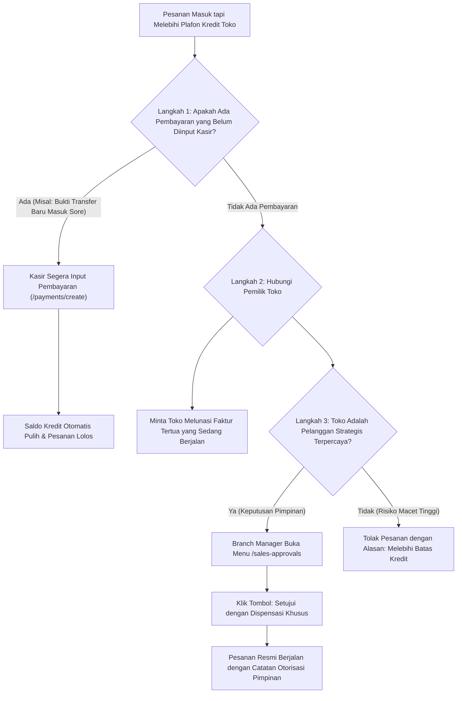
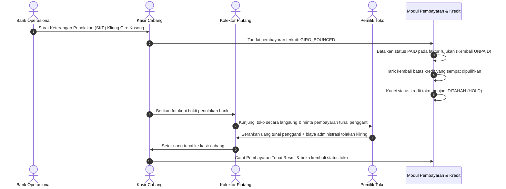

# Dokumen Proses Bisnis 14: Panduan Penanganan Kendala Operasional & Solusi Bisnis

Dokumen ini adalah manual panduan cepat (*Troubleshooting & Exception Handling Guide*) untuk membantu staf operasional, tenaga penjual, petugas gudang, dan staf keuangan dalam menangani berbagai situasi pengecualian atau kendala yang sering terjadi di lapangan.

---

## 1. Matriks Penanganan Cepat Kendala Operasional

| Gejala Kendala | Modul Terkait | Penyebab Umum | Tindakan Solusi Bisnis Terstandarisasi |
| :--- | :--- | :--- | :--- |
| **Pesanan Tertahan (*Pending Approval*)** | Pesanan Penjualan | Plafon kredit habis, ada faktur lewat jatuh tempo, atau diskon di atas batas normal. | Buka menu `/sales-approvals`. Branch Manager dapat meninjau alasan penahanan dan menggunakan tombol **✓ Setujui (Dispensasi)** jika toko layak diprioritaskan. |
| **Stok Gudang Tidak Cukup** | Pergudangan & SO | Jumlah barang fisik di gudang cabang lebih sedikit dari pesanan. | 1. Terbitkan pesanan dengan kuantitas parsial yang tersedia. 2. Ajukan Pengiriman Antar-Gudang darurat dari Gudang Pusat Cakung via menu `/warehouse-transfers`. |
| **Toko Tutup saat Supir Datang** | Pengiriman Armada | Toko tutup hari raya, pemilik tidak di tempat, atau banjir di sekitar toko. | Supir mengambil foto toko tutup, melapor ke salesman wilayah, dan membawa pulang muatan. Surat Jalan dijadwalkan ulang tanpa memotong stok gudang. |
| **Giro / Cek Ditolak Bank (Bilyet Kosong)** | Keuangan & Kasir | Saldo rekening nasabah tidak mencukupi saat tanggal jatuh tempo kliring. | Keuangan membatalkan status pelunasan faktur, memulihkan saldo utang toko, dan menghentikan pengiriman pesanan baru sampai toko membayar tunai. |
| **Salah Input Varian Produk pada SO** | Administrasi Sales | Human error staf saat memilih rasa/ukuran kemasan barang. | Batalkan pesanan sebelum terbit Surat Jalan. Jika barang terlanjur dikirim, gunakan prosedur Retur Stok Baik (*Good Stock*) saat tiba kembali di gudang. |

---

## 2. Panduan Langkah demi Langkah Penanganan Kasus

### Kasus A: Plafon Kredit Toko Habis Sementara Ada Pesanan Mendesak Masuk

---

### Kasus B: Stok di Gudang Cabang Tidak Cukup untuk Memenuhi Pesanan Toko

1. **Opsi 1: Pengiriman Parsial (Sebagian)**:
   - Diskusikan dengan pemilik toko apakah bersedia menerima kuantitas yang tersedia saat ini terlebih dahulu (misal: pesan 20 dus, kirim 12 dus yang tersedia hari ini).
   - Terbitkan Surat Jalan pertama sejumlah 12 dus.
   - Sisa 8 dus akan diterbitkan Surat Jalan kedua setelah stok tambahan tiba di gudang cabang.
2. **Opsi 2: Pengiriman Antar-Gudang Cepat (*Emergency Stock Transfer*)**:
   - Kepala Gudang memeriksa ketersediaan stok di Gudang Pusat Cakung atau cabang terdekat.
   - Mengajukan transfer stok pada menu `/warehouse-transfers/create`.
   - Menggunakan armada ekspedisi cepat antar-kota agar barang tiba dalam waktu kurang dari 24 jam.

---

### Kasus C: Bilyet Giro / Cek Mundur Ditolak oleh Bank (*Bounced Cheque*)

---

### Kasus D: Salah Input Dokumen yang Terlanjur Diproses

1. **Kondisi 1: Sales Order Masih Berstatus DRAFT / PENDING_APPROVAL**:
   - Pimpinan cukup menolak pesanan tersebut dengan mengisi alasan penolakan: *"Koreksi kesalahan varian SKU oleh pembuat pesanan"*.
   - Admin Sales membuat ulang pesanan yang benar.
2. **Kondisi 2: Surat Jalan Terlanjur Terbit Namun Truk Belum Berangkat**:
   - Kepala Gudang membatalkan pengiriman armada terkait.
   - Stok cadangan otomatis dikembalikan ke status tersedia.
3. **Kondisi 3: Barang Sudah Terlanjur Tiba di Toko Pelanggan**:
   - Pelanggan menolak varian yang salah kirim pada lembar fisik Surat Jalan.
   - Supir membawa kembali barang fisik yang salah ke gudang cabang.
   - Petugas gudang mencatat transaksi **Retur Stok Baik (*Good Stock Return*)** dengan alasan *"Salah Kirim Varian SKU"*.
   - Barang fisik masuk kembali ke rak stok siap jual dan bagian Keuangan menerbitkan Nota Kredit penyeimbang.

