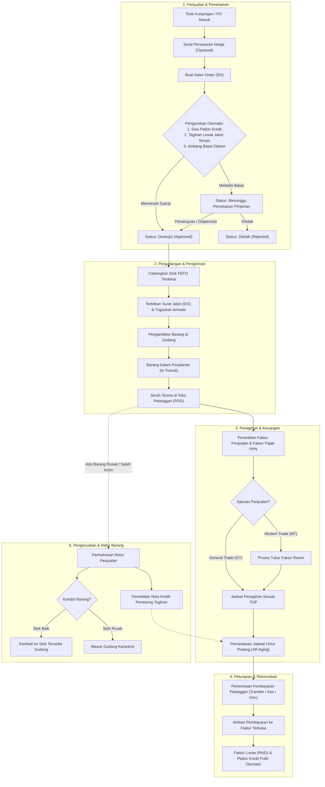

# Panduan & Dokumentasi Proses Bisnis Sistem Distribusi Enterprise

Selamat datang di pusat dokumentasi resmi alur dan proses bisnis **Enterprise Multi-Branch Sales & Distribution System**. Dokumen ini dirancang sebagai panduan komprehensif bagi manajemen, pimpinan cabang, admin operasional, tenaga penjual (*salesman*), pengelola logistik gudang, staf keuangan (*finance & billing*), maupun auditor internal untuk memahami seluruh siklus operasional bisnis perusahaan.

---

## 1. Peta Navigasi Dokumen Proses Bisnis

Dokumentasi ini disusun secara modular dalam folder `docs/`, mencakup 9 dokumen proses bisnis utama dari awal akses hingga tata kelola sistem:

| No | Berkas Dokumentasi | Fokus & Modul Utama |
| :---: | :--- | :--- |
| **01** | [`01_ALUR_LOGIN_DAN_AKSES_SISTEM.md`](01_ALUR_LOGIN_DAN_AKSES_SISTEM.md) | Kunjungan Beranda Utama, Autentikasi Pengguna, Pilihan Masuk Cepat Peran Demo, Pendaftaran Perusahaan Baru, serta Proteksi Privasi Data. |
| **02** | [`02_MANAJEMEN_PELANGGAN_DAN_KREDIT.md`](02_MANAJEMEN_PELANGGAN_DAN_KREDIT.md) | Registrasi Master Pelanggan GT & MT, Penentuan Plafon Kredit, Syarat Pembayaran (TOP), Perjanjian Kontrak Dagang MTA, Pencarian, & Deaktivasi Aman. |
| **03** | [`03_SALURAN_DISTRIBUSI_DAN_RUTE.md`](03_SALURAN_DISTRIBUSI_DAN_RUTE.md) | Pembedaan Kanal Bisnis GT vs MT, Alur Kunjungan Harian Salesman (Beat Plan), Penjualan Kanvas Mobil Langsung, Pesanan Taking Order, & Target Penjualan. |
| **04** | [`04_PENAWARAN_DAN_PESANAN_PENJUALAN.md`](04_PENAWARAN_DAN_PESANAN_PENJUALAN.md) | Penerbitan Surat Penawaran Harga, Mesin Penentuan Harga Multi-Satuan, Konversi Penawaran ke Pesanan Penjualan, Alur Persetujuan Fleksibel, & Fasilitas Dispensasi. |
| **05** | [`05_LOGISTIK_DAN_PENGIRIMAN_BARANG.md`](05_LOGISTIK_DAN_PENGIRIMAN_BARANG.md) | Penerbitan Surat Jalan (Delivery Order), Penjadwalan Armada & Supir, Pengambilan Barang Gudang FEFO, Cetak Surat Jalan 3 Rangkap, & Bukti Serah Terima (POD). |
| **06** | [`06_PERGUDANGAN_DAN_MANAJEMEN_STOK.md`](06_PERGUDANGAN_DAN_MANAJEMEN_STOK.md) | Struktur Multi-Gudang Cabang, Prioritas Pengeluaran Kedaluwarsa Terdekat (FEFO), Transfer Antar-Gudang Transit, Pemeriksaan Fisik Stok (Opname), & Buku Besar Mutasi. |
| **07** | [`07_KEUANGAN_FAKTUR_DAN_PEMBAYARAN.md`](07_KEUANGAN_FAKTUR_DAN_PEMBAYARAN.md) | Penerbitan Faktur Penjualan & Pajak PPN 11%, Prosedur Tukar Faktur Ritel Modern, Analisis Umur Piutang (AR Aging), Pembayaran Kas/Bank/Giro, & Pemulihan Plafon Kredit. |
| **08** | [`08_PENGEMBALIAN_BARANG_DAN_RETUR.md`](08_PENGEMBALIAN_BARANG_DAN_RETUR.md) | Klasifikasi Retur Stok Baik vs Stok Rusak, Alur Karantina Gudang, Otorisasi Persetujuan Retur, Penerbitan Nota Kredit, & Pengurangan Tagihan Faktur. |
| **09** | [`09_ADMINISTRASI_DAN_PENGATURAN.md`](09_ADMINISTRASI_DAN_PENGATURAN.md) | CMS Pengaturan Slide & Konten Beranda Utama, Manajemen Pengguna Staf, Matriks 19 Peran & Hak Akses Minimum, Jejak Rekam Transaksi, & Panel Pengawasan Platform. |
| **10** | [`10_SOP_DAN_PANDUAN_OPERASIONAL_HARIAN.md`](10_SOP_DAN_PANDUAN_OPERASIONAL_HARIAN.md) | SOP Rutinitas Buka Pagi (Morning Briefing), Muat Truk & Mobil Kanvas, Operasi Lapangan, Serah Terima Kasir Sore (EOD), & Tutup Buku Bulanan (EOM). |
| **11** | [`11_KATALOG_PRODUK_DAN_PROMOSI_DAGANG.md`](11_KATALOG_PRODUK_DAN_PROMOSI_DAGANG.md) | Hirarki Produk, Matriks Multi-Satuan Kemasan (UOM Karton/Pak/Pcs), Standar COGS, Diskon Berjenjang On-Invoice, Rabat Off-Invoice, & Barang Bonus Gratis. |
| **12** | [`12_PENERIMAAN_BARANG_DARI_PRINCIPAL.md`](12_PENERIMAAN_BARANG_DARI_PRINCIPAL.md) | Inbound Logistik, Pemeriksaan Segel & Fisik Muatan Pabrik, Standar Sisa Masa Simpan, Penataan Zona & Rak Gudang, GRN, serta Penanganan Selisih Barang Masuk. |
| **13** | [`13_LAPORAN_DAN_ANALISIS_BISNIS.md`](13_LAPORAN_DAN_ANALISIS_BISNIS.md) | Ekosistem Laporan Eksekutif & Operasional, Analisis Kontribusi Kanal GT vs MT, Rasio Kesehatan Piutang, Analisis Variansi Opname, & Ekspor Berkas CSV. |
| **14** | [`14_PANDUAN_PENANGANAN_KENDALA_BISNIS.md`](14_PANDUAN_PENANGANAN_KENDALA_BISNIS.md) | Manual Solusi Cepat: Penanganan Plafon Habis, Kekurangan Stok Mendesak, Toko Tutup saat Kirim, Tolakan Kliring Bilyet Giro Kosong, & Koreksi Dokumen. |
| **15** | [`15_GLOSARIUM_ISTILAH_DISTRIBUSI_FMCG.md`](15_GLOSARIUM_ISTILAH_DISTRIBUSI_FMCG.md) | Kamus Lengkap Istilah Bisnis FMCG: GT, MT, TO, Kanvas, Beat Plan, FEFO, POD, UOM, MTA, DPP, PPN, AR Aging, Credit Limit, Bad Stock, TTF, SOA, dll. |

---

## 2. Diagram Alir Proses Bisnis Ujung-ke-Ujung (End-to-End)

Diagram berikut merangkum perjalanan satu transaksi bisnis utuh di dalam sistem, mulai dari penetapan rute toko hingga penagihan dan pelunasan piutang:

---

## 3. Matriks Peran & Tanggung Jawab Operasional

Sistem menggunakan pembagian peran kerja fungsional yang terdefinisi dengan jelas:

| Peran Fungsional | Tanggung Jawab Utama dalam Proses Bisnis |
| :--- | :--- |
| **Super Administrator** | Tata kelola perusahaan, manajemen kuota cabang/gudang, pendaftaran pengguna, dan pemantauan sistem secara menyeluruh. |
| **Branch Manager** | Menyetujui Sales Order bernilai tinggi, memberikan dispensasi limit kredit/piutang menunggak, menyetujui transfer stok dan penyesuaian opname cabang. |
| **Sales Administrator** | Input Sales Order dari pelanggan/salesman, membuat penawaran harga, memantau antrean pesanan, dan mencetak rekapitulasi penjualan. |
| **Key Account Manager (KAM MT)** | Mengelola akun jaringan supermarket/hypermarket, memasukkan kontrak dagang MTA, mendaftarkan nomor PO resmi, dan mengatur tukar faktur. |
| **Salesman GT (Taking Order)** | Melakukan kunjungan toko harian sesuai jadwal Beat Plan, memeriksa stok toko pelanggan, dan mencatat pesanan penjualan langsung. |
| **Salesman Kanvas Mobil** | Membawa stok fisik di kendaraan armada, menjual dan menyerahkan barang secara langsung di toko kelontong/grosir, serta rekonsiliasi kas dan sisa stok harian. |
| **Kepala Gudang (Warehouse Keeper)** | Melakukan alokasi stok berprinsip barang kedaluwarsa terdekat (FEFO), menerbitkan surat jalan pengiriman, memeriksa stok fisik berkala (opname), dan mengelola transfer stok antar-gudang. |
| **Staf Penagihan & Keuangan (Finance & Billing)** | Menerbitkan faktur komersial dan faktur pajak PPN 11%, memonitor jadwal umur piutang (AR Aging), mencatat bukti bayar kas/bank/giro, dan mengelola retur penjualan. |
| **Kolektor Piutang (AR Debt Collector)** | Melakukan kunjungan penagihan faktur jatuh tempo ke pelanggan General Trade dan mengumpulkan pembayaran di lapangan. |

---

## 4. Nilai-Nilai Kepatuhan & Jaminan Sistem

1. **Integritas Mutasi Stok Tidak Terbantahkan (*Immutable Stock Ledger*)**: Setiap perpindahan barang (penerimaan, alokasi, pengiriman, retur, transfer, penyesuaian opname) dicatat secara permanen dengan nomor bukti dan referensi dokumen terkait.
2. **Kepatuhan Pajak & Legalitas Perdagangan**: Mendukung penomoran faktur pajak resmi dengan tarif PPN 11%, pencatatan NPWP/NIK pelanggan, dan dokumen serah terima 3 rangkap.
3. **Pemisahan Data & Privasi Terlindung (*Multi-Tenant Privacy*)**: Data pelanggan, riwayat transaksi, laporan keuangan, dan saldo stok terlindungi penuh di balik sistem autentikasi aman tanpa ada data yang bocor ke publik.
4. **Bahasa Bisnis yang Bersahabat**: Seluruh pesan sistem, notifikasi, dan antarmuka menggunakan Bahasa Indonesia operasional yang jelas, ringkas, dan mudah dipahami oleh seluruh lini staf lapangan maupun kantor.

